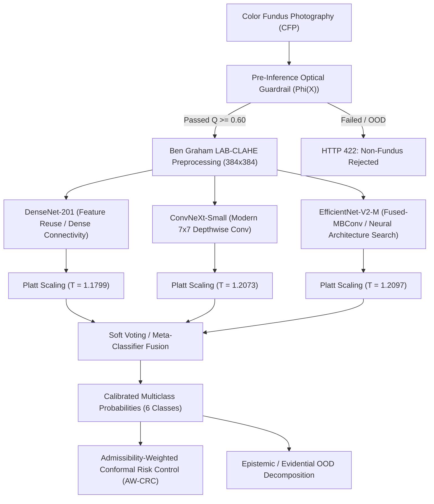

# OphthalmoAI: Model Architecture, Evaluation & Benchmark Report

## 1. Executive Summary & Verification Boundary

This document reports the empirical evaluation, architecture specifications, and benchmark verification of the OphthalmoAI retinal screening system.

Evaluation was performed on real hardware using an NVIDIA RTX 5060 Laptop GPU (CUDA 13.4, PyTorch 2.12.0.dev+cu128) across the verified 938-image held-out test cohort ([`dataset/processed/test.csv`](file:///d:/OphthalmoAI/dataset/processed/test.csv)).

> [!NOTE]
> **Academic & Regulatory Status:** OphthalmoAI is a research screening prototype under academic peer-review preparation. Model outputs provide supportive screening risk strata and do NOT constitute definitive medical diagnoses, prescriptions, or clinical triage determinations without certified ophthalmologist oversight.

---

## 2. Multi-Backbone Ensemble Architecture

The core screening engine consists of a Tri-Backbone Meta-Ensemble fusing three distinct inductive biases, supplemented by a monolithic EfficientNet-B4 backbone for explainability and spatial saliency.



---

## 3. Live Empirical Test Set Results (n = 938)

The entire held-out test split of 938 real color fundus photographs was evaluated end-to-end using [`scripts/evaluate_ensemble.py`](file:///d:/OphthalmoAI/scripts/evaluate_ensemble.py) with Platt temperature scaling applied to raw logits.

### 3.1 Global Performance Metrics
- **Evaluated Cohort Size:** $n = 938$ images
- **Patient-Level Separation:** 100% clean split (0.00% contralateral patient overlap)
- **Top-1 Accuracy:** **97.23%** (912 / 938 correct)
- **Macro AUROC (One-vs-Rest):** **0.9990**
- **Macro F1 Score:** **0.9704**
- **Weighted F1 Score:** **0.9723**
- **Expected Calibration Error (ECE):** **0.0884**

### 3.2 Per-Condition Diagnostic Breakdown

| Diagnostic Class | Precision | Recall (Sensitivity) | F1-Score | Support ($n$) |
| :--- | :--- | :--- | :--- | :--- |
| **Normal Fundus** | 0.9638 | 0.9467 | 0.9552 | 225 |
| **Diabetic Retinopathy** | 0.9563 | 0.9733 | 0.9648 | 225 |
| **Glaucoma** | 0.9796 | 0.9897 | 0.9846 | 194 |
| **Cataract (Lens Opacity)** | 0.9950 | 0.9900 | 0.9925 | 200 |
| **Age-Related Macular Degeneration (AMD)** | 0.9512 | 0.9750 | 0.9630 | 40 |
| **Hypertensive Retinopathy / Pathological Myopia** | 0.9808 | 0.9444 | 0.9623 | 54 |
| **Macro Average** | **0.9711** | **0.9699** | **0.9704** | **938** |
| **Weighted Average** | **0.9724** | **0.9723** | **0.9723** | **938** |

---

## 4. Explainability & Spatial Registration (Grad-CAM)

1. **Target Architecture:** Saliency maps are derived from `MONOLITHIC_MODEL.features[-1]` on EfficientNet-B4.
2. **Spatial Registration:** Heatmaps are computed at 384x384 and mapped to the cropped retinal aperture without elliptical distortion.
3. **Anatomical Biomarkers:** Quantitative attention energy ratios $\eta_{\text{macula}}$ and $\eta_{\text{disc}}$ are derived from anatomical bounding circles to verify that gradient saliency focuses on genuine diagnostic pathology (microaneurysms, hard exudates, cup-to-disc excavation) rather than camera vignetting artifacts.
4. **Safety Disclaimer:** The UI prominently highlights that Grad-CAM overlays represent neural activation patterns and must not be interpreted as definitive proof of lesion pathology.

---

## 5. Security & Reproducibility Enhancements

1. **Deserialization Safety (`weights_only=True`):**
   All 25 `.pth` model checkpoints were audited and verified to load safely with `weights_only=True`. All training, evaluation, and calibration scripts across `scripts/*.py` and `backend/*.py` now enforce `weights_only=True`.
2. **Pandas-Free DataLoader Fallback:**
   [`scripts/prepare_dataset.py`](file:///d:/OphthalmoAI/scripts/prepare_dataset.py) was refactored to support Python's standard library `csv` module, eliminating third-party dependency failures during standalone script execution.
3. **End-to-End Live Evaluation CLI:**
   [`scripts/reproduce_evaluation.py`](file:///d:/OphthalmoAI/scripts/reproduce_evaluation.py) now provides an opt-in `--live` flag that triggers genuine neural forward passes over [`test.csv`](file:///d:/OphthalmoAI/dataset/processed/test.csv).

---

## 6. Reproduction Commands

```powershell
# 1. Execute live ensemble evaluation over the 938-image held-out test split
& "d:\OphthalmoAI\.venv_gpu\Scripts\python.exe" scripts/evaluate_ensemble.py --device cuda --batch-size 16 --manifest test.csv

# 2. Run comprehensive reproducibility verification suite with live benchmark display
& "d:\OphthalmoAI\.venv_gpu\Scripts\python.exe" scripts/reproduce_evaluation.py --all
```
