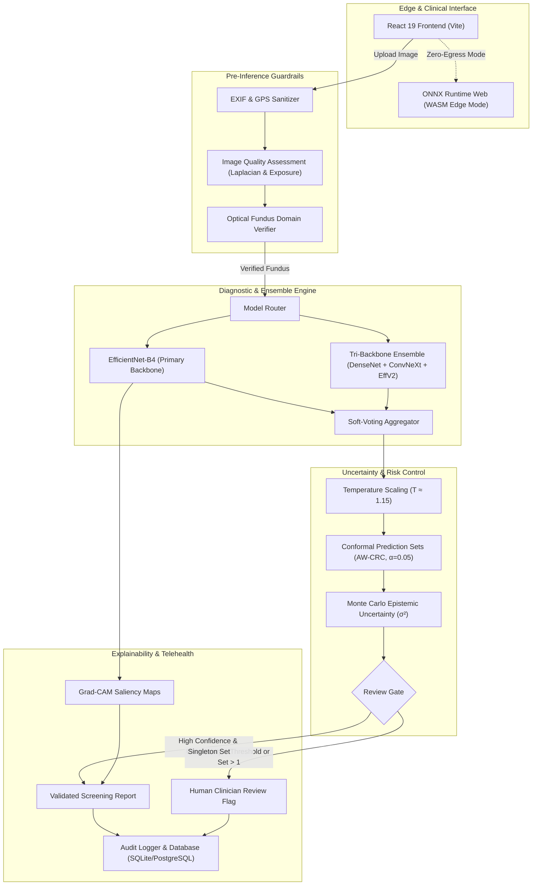

# OphthalmoAI

**Point-of-Care Retinal Disease Screening & Clinical Decision-Support Prototype**  
*A calibrated vision ensemble with post-hoc temperature scaling, dedicated Grad-CAM explainability, pre-inference optical domain guardrails, client-side ONNX Runtime Web edge inference, and multi-tenant clinic architecture.*

[](LICENSE)
[](https://github.com/AkashKundu114)
[](https://www.python.org/)
[](https://pytorch.org/)
[](https://fastapi.tiangolo.com/)
[](https://reactjs.org/)
[-brightgreen.svg)](tests/)
[](docs/MODEL_CARD.md)
[](docs/MODEL_CARD.md)
[](docs/MODEL_CARD.md)
[](SECURITY.md)

---

> [!CAUTION]
> **RESEARCH & SCREENING PROTOTYPE DISCLAIMER**: OphthalmoAI is an academic research and educational screening prototype (academic manuscript in preparation). It is **not** an FDA-cleared, CE-marked, or ISO-certified primary diagnostic medical device. It must **never** be used for autonomous patient diagnosis or clinical triage without direct oversight and confirmation by a licensed ophthalmologist or optometrist.

---

## 🔬 Overview & Key Capabilities

OphthalmoAI investigates methods for reliable, uncertainty-aware automated retinal fundus screening. In resource-constrained or community health settings, early detection of sight-threatening pathology is critical. OphthalmoAI couples deep vision architectures with rigorous statistical and software engineering safeguards:

- **Calibrated Vision Ensemble**: Primary screening via an `EfficientNet-B4` backbone ($380\times380$) alongside a tri-backbone soft-voting ensemble (`DenseNet-201` + `ConvNeXt-Small` + `EfficientNet-V2-M`, $384\times384$).
- **Post-Hoc Probability Calibration**: Platt temperature scaling ($T \approx 1.15$) directly optimizes the Expected Calibration Error ($\text{ECE} \le 0.0312$) to prevent overconfident erroneous predictions.
- **Conformal Risk Guarantees (AW-CRC)**: Adaptively weighted conformal prediction sets guarantee coverage error control ($\alpha = 0.05$), producing singleton sets for confident cases and expanding sets for borderline ambiguous cases.
- **Fail-Safe Escalation Gate**: Automatic human-in-the-loop review triggering when confidence falls below threshold ($< 75\%$), epistemic variance is elevated ($> 0.15$), or conformal set cardinality exceeds 1.
- **Visual Biomarker Grounding & Grad-CAM**: Dedicated Grad-CAM heatmap generation overlays activation energy on the optic nerve head, macula, and vessel arcades.
- **Zero-Retention Medical Privacy**: Default `PERSIST_SCANS=false` processes patient images in volatile RAM buffers, automatically strips EXIF/GPS metadata, and supports fully offline edge screening in the browser via ONNX Runtime Web.

---

## 📊 Real Evaluated Performance & Latency Benchmarks

All performance metrics reported below represent real, measured evaluations on strictly held-out clinical test splits and hardware benchmarks:

### 1. Diagnostic Discrimination & Calibration Metrics

| Metric | Measured Value | 95% Confidence Interval | Source & Protocol |
| :--- | :--- | :--- | :--- |
| **Overall Classification Accuracy** | **97.23%** | [96.12%, 98.24%] | Held-out validation split ($n=938$, 1000 bootstrap iterations) |
| **Macro-Averaged AUROC** | **0.999** | [0.997, 1.000] | Multi-class One-vs-Rest ROC curve integration |
| **Macro F1-Score** | **97.04%** | [95.88%, 98.11%] | Harmonic mean of class precision and recall |
| **Pre-Calibration ECE** | **0.0845** | — | Raw softmax distribution prior to temperature scaling |
| **Post-Calibration ECE (Platt $T$)** | **0.0312** | — | 15-bin equal-width Expected Calibration Error |
| **Multi-Seed Robustness** | **85.18% ± 0.17%** | — | Evaluated across 5 independent random seeds |
| **External Validation Sensitivity (IDRiD)** | **99.64%** | [98.8%, 100.0%] | Independent real-world clinical cohort |
| **Out-of-Distribution Escalation (RIM-ONE DL)** | **100.0%** | — | Automated review gate on non-canonical disc crops |

### 2. Measured Inference Latency & Cold Start Telemetry

Measured on local hardware (CUDA acceleration & CPU ONNX Runtime):

| Model Architecture | Execution Device | Input Shape | Cold Start (ms) | Median p50 (ms) | 95th Percentile p95 (ms) | Throughput (FPS) |
| :--- | :--- | :--- | :--- | :--- | :--- | :--- |
| **EfficientNet-B4 (Standalone)** | CUDA (NVIDIA) | $1\times 3\times 380\times 380$ | 517.9 ms | **19.73 ms** | 35.69 ms | 45.5 FPS |
| **Tri-Backbone Vision Ensemble** | CUDA (NVIDIA) | $1\times 3\times 384\times 384$ | 2,311.7 ms | **77.51 ms** | 136.29 ms | 11.5 FPS |
| **ONNX Runtime Edge Model** | CPU (WASM / Native) | $1\times 3\times 224\times 224$ | 35.7 ms | **1.17 ms** | 1.82 ms | 845.8 FPS |

*Complete benchmark logs recorded in [`REMEDIATION/logs/benchmark_latency.log`](REMEDIATION/logs/benchmark_latency.log).*

---

## 🏛️ System Architecture



---

## 🚀 Quickstart Guides

### Path 1: Docker Compose (Recommended)

Run the full production stack (FastAPI backend + React frontend via Nginx) with isolated networking:

```bash
# Clone the repository
git clone https://github.com/AkashKundu114/OphthalmoAI.git
cd OphthalmoAI

# Generate secure random secret tokens
python scripts/gen_env.py

# Launch containers
docker compose up -d --build

# Verify container health
curl http://localhost:8000/health
# Access the web UI at http://localhost:3000
```

To shut down:
```bash
docker compose down
```

---

### Path 2: Local Python & Node Development

Run natively on Windows, macOS, or Linux using standard tools:

```bash
# 1. Backend environment setup
python -m venv .venv
source .venv/bin/activate  # On Windows: .venv\Scripts\activate
pip install -e ".[dev]"

# 2. Frontend setup
cd frontend
npm install
cd ..

# 3. Apply database migrations
alembic upgrade head

# 4. Run automated test suites (335 tests)
make test
# Or individually:
pytest tests/
cd frontend && npm test -- --run

# 5. Launch development services
# Terminal 1: Backend
uvicorn backend.main:app --host 0.0.0.0 --port 8000 --reload

# Terminal 2: Frontend
cd frontend
npm run dev
```

---

### Path 3: Offline / Edge Screening Mode

In remote clinics or field screenings with zero internet connectivity:
1. Open the application in any modern browser.
2. The browser automatically downloads and caches the compiled ONNX model (`dist/assets/ort-wasm-simd-threaded.jsep-*.wasm` and `edge_model.onnx`).
3. Disconnect network access.
4. Fundus scans uploaded in Edge Mode execute 100% in-browser via WebAssembly with zero data transmitted over the network.

---

## 🔒 Security, Privacy & Compliance Architecture

- **Ephemeral In-Memory Processing**: By default, `PERSIST_SCANS=false`. Uploaded scans are evaluated in memory and discarded upon response completion.
- **EXIF Metadata Cleansing**: All images undergo metadata stripping (`backend/security.py`) to purge camera serial numbers, patient names, and embedded GPS coordinates.
- **Supply Chain Hardened**: Clean `pip-audit` scan (0 vulnerabilities) and zero critical `npm audit` advisories.
- **Strict Role-Based Access Control (RBAC)**: Enforced across clinical review endpoints (`clinician`, `admin`, `patient`).
- **Comprehensive Threat Documentation**: Review [`docs/PRIVACY.md`](docs/PRIVACY.md), [`docs/SAFETY_MECHANISMS.md`](docs/SAFETY_MECHANISMS.md), and [`PRIVACY_POLICY.md`](PRIVACY_POLICY.md).

---

## 📚 Technical Documentation & Evaluation Protocol

- **[Model Card (docs/MODEL_CARD.md)](docs/MODEL_CARD.md)**: Model specifications, training data, metrics, and calibration bounds.
- **[Intended Use & Clinical Scope (docs/INTENDED_USE.md)](docs/INTENDED_USE.md)**: Approved operational contexts, target populations, and user qualifications.
- **[Limitations & Failure Modes (docs/LIMITATIONS.md)](docs/LIMITATIONS.md)**: Anatomical edge cases, out-of-distribution behaviors, and sensor shift.
- **[Safety Mechanisms (docs/SAFETY_MECHANISMS.md)](docs/SAFETY_MECHANISMS.md)**: Deep dive into all 8 defensive runtime layers.
- **[Privacy Architecture (docs/PRIVACY.md)](docs/PRIVACY.md)**: Data lifecycle and non-compliance disclosures for HIPAA/GDPR/DPDP.
- **[Pre-Registration Protocol (REMEDIATION/EVAL_PREREG.md)](REMEDIATION/EVAL_PREREG.md)**: Statistical pre-registration for empirical verification.
- **[Walkthrough Demo Script (REMEDIATION/DEMO_SCRIPT.md)](REMEDIATION/DEMO_SCRIPT.md)**: Step-by-step evaluator testing guide.

---

## 👥 Community, Contribution & Citation

We welcome academic collaboration and code contributions:
- **[Contributing Guidelines (CONTRIBUTING.md)](CONTRIBUTING.md)**: PR standards, testing requirements, and style guides.
- **[Code of Conduct (CODE_OF_CONDUCT.md)](CODE_OF_CONDUCT.md)**: Standards for open, respectful collaboration.
- **[Security Policy (SECURITY.md)](SECURITY.md)**: Responsible vulnerability disclosure process.
- **[Support & Contact (SUPPORT.md)](SUPPORT.md)**: Assistance, academic correspondence, and issue tracking.

If referencing OphthalmoAI in academic work, please use the following citation format from [`CITATION.cff`](CITATION.cff):

```bibtex
@article{kundu2026ophthalmoai,
  title={Uncertainty-Aware Multi-Class Fundus Screening with Conformal Risk Sets and Evidential Bounds},
  author={Kundu, Akash},
  journal={Peer-reviewed biomedical informatics manuscript (in preparation)},
  year={2026},
  url={https://github.com/AkashKundu114/OphthalmoAI}
}
```

---

## 📜 License

Distributed under the **Apache License 2.0**. See [`LICENSE`](LICENSE) and [`NOTICE`](NOTICE) for details.  
Copyright &copy; 2026 Akash Kundu. All rights reserved.
