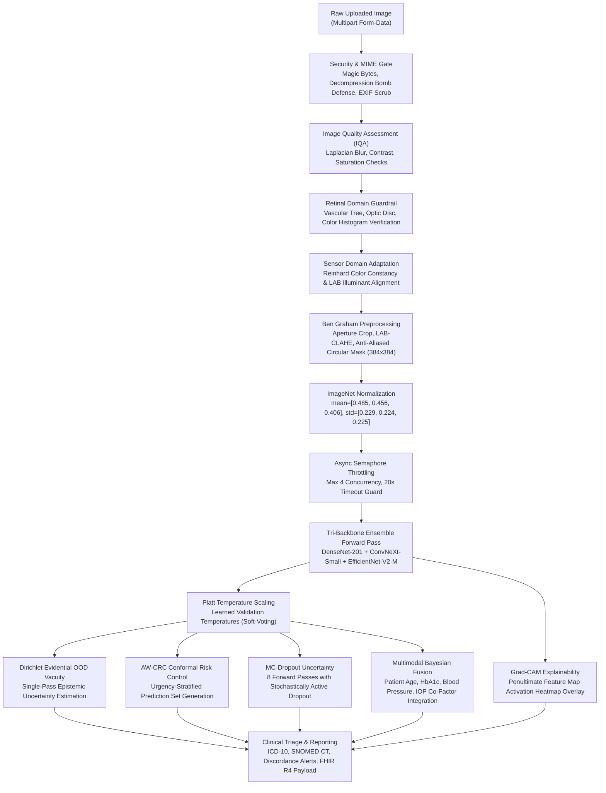

# OphthalmoAI Architecture & System Design

> **Academic Research Prototype Notice**: This system is designed for medical image informatics research and clinical decision support benchmarking. It is an **academic research manuscript in preparation** and is not certified as an independent medical device for autonomous diagnosis.

---

## 1. High-Level Architecture Overview

OphthalmoAI is structured into a modular, decoupled architecture providing dual-track inference capabilities:
1. **Server-Side Full-Precision Ensemble (Cloud / Clinic)**: PyTorch tri-backbone ensemble with Platt temperature calibration, Dirichlet evidential out-of-distribution (OOD) detection, Admissibility-Weighted Conformal Risk Control (AW-CRC), and Grad-CAM explainability.
2. **Client-Side Edge Inference (Offline / Remote PHC)**: Quantized MobileNetV3-Small ONNX model running entirely client-side inside the web browser via WebAssembly (`onnxruntime-web`) with zero network egress.

```
┌────────────────────────────────────────────────────────────────────────┐
│                          Client Presentation                           │
│     React 19 + Vite 7 + Tailwind CSS (Responsive Viewports 320px-4K)   │
└────────────────────────────────────┬───────────────────────────────────┘
                                     │
           ┌─────────────────────────┴────────────────────────┐
           ▼                                                  ▼
┌───────────────────────────────┐        ┌───────────────────────────────┐
│     Client-Side Edge Engine   │        │     Server-Side Screening API │
│ • onnxruntime-web (WASM)      │        │ • FastAPI Asynchronous App   │
│ • Quantized INT8 MobileNetV3  │        │ • Tri-Backbone PyTorch Engine │
│ • Zero External Network Egress│        │ • Conformal Triage & Grad-CAM │
└───────────────────────────────┘        └──────────────┬────────────────┘
                                                        │
                ┌───────────────────────────────────────┴───────────────────────────────────────┐
                ▼                                       ▼                                       ▼
    ┌───────────────────────┐               ┌───────────────────────┐               ┌───────────────────────┐
    │  Screening Services   │               │   Clinical Services   │               │  System & Telemetry   │
    │ • image_preprocessor  │               │ • Clinical Codes      │               │ • Prometheus Metrics  │
    │ • model_loader        │               │ • FHIR R4 Export      │               │ • OpenTelemetry Trace │
    │ • inference_service   │               │ • Clinician Overrides │               │ • Multi-Tenancy Engine│
    │ • explanation_service │               │ • Telehealth Chat/TTS │               │ • CBMIR Vector Search │
    └───────────────────────┘               └───────────────────────┘               └───────────────────────┘
```

---

## 2. Server-Side Modular Layout

The backend service is organized into dedicated, single-responsibility modules:

- **`backend/config.py`**: Centralized configuration defining image dimensions (384x384), ImageNet normalization constants (`mean=[0.485, 0.456, 0.406]`, `std=[0.229, 0.224, 0.225]`), canonical 6 retinal disease classes, hardware device placement, concurrency limits, and environment flags.
- **`backend/services/`**:
  - `image_preprocessor.py`: Ben Graham anatomical color-preserving CLAHE, aperture cropping, anti-aliased circular masking, and tensor transformation.
  - `model_loader.py`: Safe PyTorch model constructors and checkpoint loader with `weights_only=True` integrity enforcement.
  - `inference_service.py`: Concurrency-throttled forward passes, Platt temperature scaling, Dirichlet evidential vacuity, and clinical symptom discordance rules.
  - `explanation_service.py`: Class Activation Mapping (Grad-CAM) targeting penultimate convolutional feature maps, overlay blending, and anatomical lesion description synthesis.
- **`backend/routes/`**:
  - `screening.py`: Synchronous and asynchronous screening endpoints (`/api/predict`, `/api/v1/screen/async`, `/scans/compress`).
  - `clinical.py`: Disease encyclopedia, FHIR R4 diagnostic reports, clinician sign-off/overrides, and tele-ophthalmology scheduling.
  - `telehealth.py`: Multilingual Indic AI doctor guidance (Google Gemini / Ollama local LLM) and Sarvam speech integration.
  - `auth_routes.py`: Role-based access control (RBAC), password strength verification, and JWT session management.
  - `system.py`: Prometheus metrics exposition, distributed tracing, CBMIR vector search, demographic fairness audits, and multi-tenant isolation.
- **`backend/main.py`**: Lean application lifecycle orchestrator mounting middleware, exception handlers, and modular routers while preserving full backward compatibility.

---

## 3. End-to-End Image Processing & Diagnostic Dataflow



---

## 4. Key Scientific & Algorithmic Modules

### 4.1 Anatomical Color-Preserving Preprocessing (Ben Graham LAB-CLAHE)
Standard Gaussian subtraction methods alter chromatic diagnostic signatures (e.g., turning yellow lipid exudates or dark red microaneurysms into artificial grayscale artifacts). OphthalmoAI implements:
1. **Aperture Crop**: Square bounding crop preserving original retinal circle aspect ratio without elliptical stretching.
2. **Luminance-Isolated CLAHE**: Conversion to CIE-LAB color space; adaptive histogram equalization is applied *strictly* to the L (luminance) channel while preserving true A and B chrominance channels.
3. **Anti-Aliased Circular Mask**: Smooth circular aperture mask filtering high-frequency camera rim border noise.

### 4.2 Calibrated Tri-Backbone Soft-Voting Ensemble
Logits $z_m$ from each backbone $m \in \{\text{DenseNet-201}, \text{ConvNeXt-Small}, \text{EfficientNet-V2-M}\}$ are scaled by learned Platt temperatures $T_m$:
$$\hat{p}_{m,k} = \frac{\exp(z_{m,k} / T_m)}{\sum_{j=1}^K \exp(z_{m,j} / T_m)}$$
Ensemble probabilities are derived via calibrated arithmetic averaging:
$$\bar{p}_k = \frac{1}{M} \sum_{m=1}^M \hat{p}_{m,k}$$

### 4.3 Admissibility-Weighted Conformal Risk Control (AW-CRC)
Guarantees marginal statistical coverage under arbitrary data distributions:
$$\mathbb{P}(Y \in \mathcal{C}(X)) \ge 1 - \alpha$$
Candidate prediction sets $\mathcal{C}(X)$ adaptively expand to include alternative differential diagnoses when images exhibit sensor domain shift, elevated epistemic vacuity, or optical blur.

### 4.4 Grad-CAM Visual Grounding
Class-specific gradients are backpropagated to the final convolutional feature layer:
$$\alpha_k^c = \frac{1}{Z} \sum_{i} \sum_{j} \frac{\partial Y^c}{\partial A_{i,j}^k}$$
$$L_{\text{Grad-CAM}}^c = \text{ReLU}\left(\sum_k \alpha_k^c A^k\right)$$
The resulting heatmap is rendered as a 300+ DPI compatible overlay for clinician interpretability.
