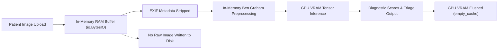

# OphthalmoAI: Medical-Image Privacy & Adversarial Security Architecture

> **Security & Privacy Specification**: Technical implementation details of data governance, in-memory processing, adversarial input defenses, and regulatory privacy controls.

---

## 1. Image Lifecycle & Zero-Disk Egress Policy

Retinal fundus photographs represent sensitive biometric and medical health information (PHI). OphthalmoAI enforces strict data-retention boundaries:

### 1.1 In-Memory Buffer Processing
- Uploaded byte streams (`contents = await file.read()`) are decoded purely in memory using `PIL.Image.open(io.BytesIO(contents))`.
- Raw uncompressed image arrays are never spilled to `/tmp` or persistent local directories during standard screening passes.
- After inference concludes, Python garbage collection (`gc.collect()`) and CUDA cache release (`torch.cuda.empty_cache()`) are invoked in the route's `finally:` block.

### 1.2 Metadata & EXIF Stripping
All uploaded image rasters are processed through `strip_image_metadata()` in `backend/security.py`:
- Strips camera serial numbers, GPS geographic coordinates, device identifiers, and patient tags.
- Re-encodes pure RGB pixel arrays without embedded metadata profiles.

### 1.3 Stateless Screening Mode
Setting `PERSIST_SCANS=false` disables database persistence entirely:
- Predictions, triage flags, and Grad-CAM overlays are returned in the HTTP response body and immediately dereferenced from server memory.

---

## 2. Adversarial & Malicious Upload Hardening

OphthalmoAI incorporates defense-in-depth measures against common web and medical-imaging attack vectors:

### 2.1 Decompression Bomb (Pixel Flood) Defenses
- **Maximum Pixel Ceiling**: Enforces `_MAX_PIXELS = 25,000,000` (25 Megapixels) via Pillow and custom pre-flight header inspectors.
- **Maximum Axis Dimension**: Rejects any image whose width or height exceeds 6,000 pixels.
- **Extreme Aspect Ratio Guard**: Rejects extreme aspect ratio strips ($\text{aspect} > 4.0$ or $< 0.25$) designed to trigger high-memory resizing bottlenecks.

### 2.2 Magic Byte & Polyglot File Validation
- Rejects extension-spoofed payloads (e.g., an executable or HTML script named `scan.jpg`).
- Examines raw header signatures:
  - JPEG: `\xFF\xD8\xFF`
  - PNG: `\x89PNG\r\n\x1a\n`
  - TIFF: `II*\x00` or `MM\x00*`
- Rejects unverified or mismatched MIME streams with HTTP 415 Unsupported Media Type.

### 2.3 Retinal Fundus Domain Guardrail (`fundus_validator.py`)
- Analyzes candidate images for anatomical hallmarks of authentic color fundus photography:
  - Concentric circular aperture boundary
  - Retinal vascular arborization structure
  - Optic nerve head luminance and disc localization
  - Retinal chrominance distribution (dominance of red/orange pigment over green/blue channels)
- Rejects non-ophthalmic photographs (faces, everyday objects, noise patterns, chest X-rays) with HTTP 422 Unprocessable Content.
- Auto-corrects BGR/RGB channel swap if detected to ensure neural models receive standard clinical color spectrums.

### 2.4 GPU Resource Throttling & VRAM Protection
- Protected by an asynchronous semaphore (`_INFERENCE_SEMAPHORE` with default limit of 4 concurrent passes).
- Acquires slot with a 20.0-second timeout. If clinical inference capacity is saturated, the server returns HTTP 503 rather than queuing indefinitely and causing memory exhaustion.

### 2.5 Insecure Deserialization Prevention
- All PyTorch model loaders enforce `torch.load(..., weights_only=True)`.
- Prevents arbitrary Python code execution via malicious pickle payloads in model weights.

### 2.6 Broken Object Level Authorization (IDOR) & Injection Protections
- All scan retrieval (`/scans/{scan_id}/details`) and longitudinal history (`/scans/history/{user_id}`) endpoints verify that the requesting user's identity and role match the queried record.
- Identifiers are validated against strict alphanumeric regexes (`^[a-zA-Z0-9_\-]+$`) with length bounds ($\le 64$ characters) to eliminate SQL injection and path traversal risks.

---

## 3. Security Headers & Network Hygiene

The `SecurityHeadersMiddleware` automatically injects the following security headers into every HTTP response:

| Header | Production Value | Purpose |
| :--- | :--- | :--- |
| `Content-Security-Policy` | Strict directive prohibiting unauthorized remote scripts | Prevents Cross-Site Scripting (XSS) |
| `X-Content-Type-Options` | `nosniff` | Blocks MIME-type sniffing |
| `X-Frame-Options` | `DENY` | Prevents UI clickjacking |
| `Strict-Transport-Security` | `max-age=63072000; includeSubDomains; preload` | Enforces HTTPS encryption |
| `Referrer-Policy` | `strict-origin-when-cross-origin` | Minimizes URL leakage |
| `Permissions-Policy` | `camera=(), microphone=(), geolocation=()` | Restricts browser hardware access |
