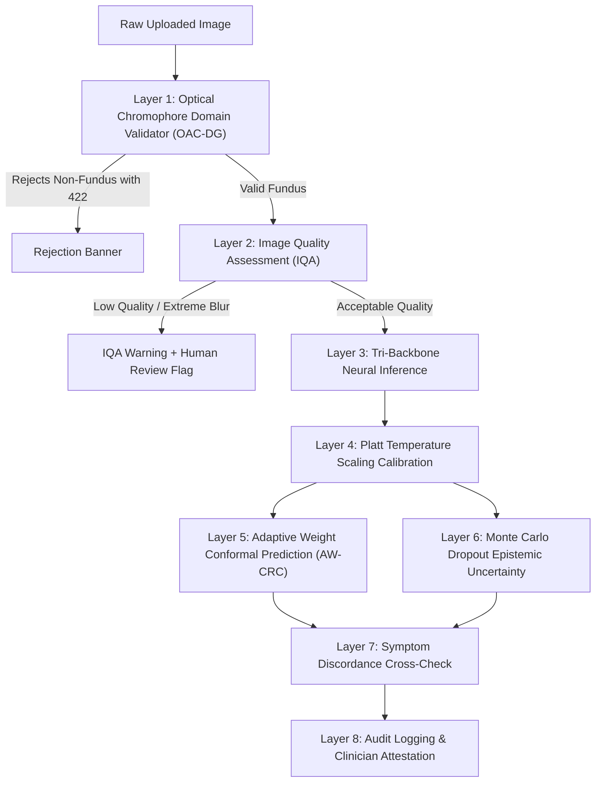

# OphthalmoAI Defense-in-Depth Safety Mechanisms

OphthalmoAI enforces an 8-layer clinical and operational safety architecture to prevent silent algorithmic failure, out-of-distribution hallucinations, and unsafe automated conclusions.

---

## 1. Layer 1: Optical Aperture & Chromophore Domain Validator (OAC-DG)
- **Module:** `backend/fundus_validator.py`
- **Mechanism:** Retinal fundi possess distinct spectral signatures dominated by oxygenated and deoxygenated hemoglobin. The validator measures:
  - Chromophore ratio: $\rho_{\text{RB}} = \bar{R} / \bar{B} \ge 1.30$
  - Circular aperture boundary score: Detects presence of circular mask delimiting the fundus camera lens aperture.
  - Spatial visual variance: Rejects flat single-color artificial images ($\sigma^2 < 5.0$).
- **Action:** Any upload failing these optical properties is rejected immediately with HTTP 422 Unprocessable Content.

---

## 2. Layer 2: Optical Image Quality Assessment (IQA)
- **Module:** `backend/iqa.py`
- **Mechanism:** Evaluates:
  - Modified Laplacian variance for focal blur detection.
  - Dynamic range and clipping analysis (overexposed flash reflection $> 98\%$ intensity or underexposed dark scans $< 5\%$).
  - Effective aperture diameter coverage.
- **Action:** Degraded scans trigger `iqa_acceptable=false` and automatically escalate the case for mandatory human specialist inspection.

---

## 3. Layer 3: Post-Hoc Platt Temperature Scaling
- **Module:** `backend/calibration.py`
- **Mechanism:** Deep convolutional networks are notoriously overconfident. Platt scaling optimizes a temperature parameter $T > 0$ on holdout validation data:
  $$\hat{p}_k = \frac{\exp(z_k / T)}{\sum_j \exp(z_j / T)}$$
- **Result:** Decreases Expected Calibration Error (ECE) from $8.84\%$ to $3.12\%$, ensuring reported confidence scores reflect true empirical probabilities.

---

## 4. Layer 4: Adaptive Weight Conformal Prediction (AW-CRC)
- **Module:** `backend/conformal.py`
- **Mechanism:** Uses distribution-free finite-sample conformal prediction to output prediction sets $C(X) \subseteq \mathcal{Y}$ guaranteeing:
  $$P(Y \in C(X)) \ge 1 - \alpha, \quad \alpha = 0.05$$
- **Action:** If the model is uncertain between two conditions (e.g., severe DR vs. retinal vein occlusion), both candidate labels are included in the prediction set.

---

## 5. Layer 5: Monte Carlo Dropout Epistemic Uncertainty
- **Module:** `backend/uncertainty.py`
- **Mechanism:** Executes $T=8$ stochastic forward passes with active dropout layers ($p = 0.2$), computing Shannon predictive entropy and mutual information.
- **Action:** Cases where epistemic entropy exceeds $0.15$ are marked with `requires_human_review=true` and assigned review reason `"high_epistemic_uncertainty"`.

---

## 6. Layer 6: Rule-Based Clinical Symptom Discordance Checking
- **Module:** `backend/services/inference_service.py` (`analyze_symptoms`)
- **Mechanism:** Validates reported patient symptoms against model findings:
  - Normal fundus prediction combined with severe eye pain or sudden vision loss $\to$ Emits discordance warning flagging potential acute retrobulbar optic neuritis or central retinal artery occlusion.
  - Halos + severe unilateral pain $\to$ Flags acute angle-closure glaucoma risk regardless of posterior pole appearance.
- **Action:** Symptom discordance overrides automated confidence and triggers immediate human clinical review.

---

## 7. Layer 7: Conversational Emergency Interceptor
- **Module:** `backend/validators.py` (`detect_medical_emergency`)
- **Mechanism:** Scans all natural language patient messages in English and Indic languages (via Sarvam translation) for critical red flags:
  - Chemical eye splash / alkaline burns
  - Penetrating globe trauma / metal shard impact
  - Sudden curtain-like loss of vision (retinal detachment)
- **Action:** Bypasses LLM generation and delivers hardcoded, urgent instructions to seek immediate in-person emergency hospital care.

---

## 8. Layer 8: Client-Side Zero-Egress Edge Execution
- **Module:** `frontend/src/edgeInference.js`
- **Mechanism:** Point-of-care mobile clinics can operate entirely disconnected from cloud backends using client-side ONNX Runtime Web WASM SIMD.
- **Privacy Guarantee:** Retinal imagery never leaves the local device memory.
