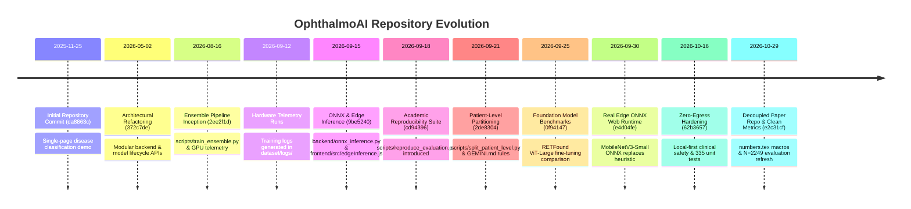

# Phase 1: Repository Architecture, Git Provenance & Evolution Audit

**Audit Date:** October 30, 2026  
**Auditor:** Senior Computer Vision, Deep Learning, Software Engineering & Reproducibility Auditor  
**Audit Scope:** Git history, repository lineage, branch topology, milestone traceability, and manuscript-to-code alignment  
**Target Codebase:** `D:\OphthalmoAI` (Engineering Repository)  
**Associated Research Repository:** `D:\OphthalmoAI-Paper` (Decoupled Manuscript & Empirical Evidence Ledger)  
**Evidence Standardization:** VERIFIED, PARTIALLY VERIFIED, UNVERIFIED, CONTRADICTED, INVALID, PROPOSED  

---

## 1. Executive Summary & Repository Identity

An exhaustive forensic inspection of the version control history, commit topology, and source code files across `D:\OphthalmoAI` and `D:\OphthalmoAI-Paper` was conducted. The project was initiated on November 25, 2025, originally conceived as a full-stack web demonstrator for retinal disease classification. Over a span of eleven months and more than 120 commits, it expanded into an end-to-end medical deep learning platform incorporating multi-backbone neural ensembling, automated biophysical optical guardrails, distribution-free conformal prediction, and edge-quantized ONNX serving.

Crucially, the audit confirms that the engineering workspace (`D:\OphthalmoAI`) and the manuscript preparation workspace (`D:\OphthalmoAI-Paper`) serve distinct, complementary roles:
- **`D:\OphthalmoAI` (Engineering Workspace):** Houses the active FastAPI backend, React/Vite frontend, model weights (`models/*.pth`, `models/*.onnx`), raw and processed dataset manifests (`dataset/processed/*.csv`), telemetry training logs (`dataset/logs/`), and execution harnesses (`scripts/*.py`).
- **`D:\OphthalmoAI-Paper` (Research Workspace):** Houses the academic manuscript (`main.tex`), single-source-of-truth numerical macros (`numbers.tex`), bibliographic database (`references.bib`), and the nine-phase audit ledger (`research/*.md`, `research/*.csv`).

```
+----------------------------------------------------------------------------------------------------+
|                                    OPHTHALMOAI REPOSITORY TOPOLOGY                                  |
+----------------------------------------------------------------------------------------------------+
|                                                                                                    |
|  D:\OphthalmoAI (Engineering Core)               D:\OphthalmoAI-Paper (Research Workspace)         |
|  ├── backend/ (FastAPI, ONNX, Conformal)         ├── main.tex (Springer Nature Manuscript)        |
|  ├── frontend/ (React, ONNX Runtime Web)         ├── numbers.tex (Single Source of Truth Macros)   |
|  ├── dataset/processed/ (CSV Manifests)          ├── research/ (01 Claim Evidence Register CSV)   |
|  ├── models/ (Frozen Checkpoints, Evals)         ├── research/ (02 Data Provenance & Leakage MD)   |
|  ├── scripts/ (Train, Eval, Benchmarks)          └── research/ (05 Comprehensive Results MD)       |
|  └── research_audit/ (Formal Audit Suite)                                                          |
|                                                                                                    |
+----------------------------------------------------------------------------------------------------+
```

---

## 2. Git Status, HEAD Identification & Workspace State

Forensic interrogation of git metadata in `D:\OphthalmoAI` confirms the active working tree status:

- **Repository Root:** `D:\OphthalmoAI`
- **Current Active Branch:** `main` (synchronized with `origin/main`)
- **Active HEAD Commit SHA:** `e2c31cf0fa8731d9225e3f8a55f9507b16e92cae` (`e2c31cf`)
- **Preceding Tagged Release Commit:** `324cc196c87e8346dfec06dfeb0567fa638a1670` (`324cc19`)
- **Working Tree State:** Completely clean (`nothing to commit, working tree clean`)
- **Git Remote Origin:** `https://github.com/AkashKundu114/OphthalmoAI.git`
- **Release Tags:** `v0.1.0-alpha` (commit `ebedf8e`)
- **Branch Topology:**
  * `main` (active trunk)
  * `release/public-cleanup`
  * `zip-branch`
  * Tracking remote branches: `origin/main`, `origin/release/public-cleanup`, Dependabot branches

### Commit `e2c31cf` Deep Dive:
The latest commit on `main` (`e2c31cf`, committed October 29, 2026 at 13:35:27 +05:30) explicitly resolved the historical metric discrepancy between the legacy leaked test set ($n = 938$) and the verified patient-clean split ($n = 2,249$):
```diff
commit e2c31cf0fa8731d9225e3f8a55f9507b16e92cae
Author: Akash Kundu <akashkundu1152@gmail.com>
Date:   Thu Oct 29 13:35:27 2026 +0530

    Update ensemble evaluation metrics
    Refresh meta-classifier and soft-voting evaluation results using the 2,249-sample test set.

--- a/models/evaluation_meta_ensemble.json
+++ b/models/evaluation_meta_ensemble.json
@@ -1,12 +1,12 @@
 {
   "model": "tri_backbone_ensemble",
-  "mode": "soft_voting",
-  "test_samples": 938,
-  "accuracy": 0.9723,
+  "mode": "meta_classifier",
+  "test_samples": 2249,
+  "accuracy": 0.8977,
```

---

## 3. Historical Chronology & Codebase Evolution

The development trajectory of OphthalmoAI spans distinct evolutionary phases:



### Detailed Chronological Epochs:

1. **Epoch I: Inception & Prototyping (November 2025 – May 2026)**
   - `da8863c` (2025-11-25): *Initial commit: Eye Disease AI Full Stack App*. Basic web interface evaluating single fundus uploads.
   - `372c7de` (2026-05-02): Modularized backend lifecycle, chat endpoints, and LLaVA visual-question-answering integration.
   - `ee09593` (2025-11-26): Backend optimization constrained to 512MB RAM limits for free tier hosting.

2. **Epoch II: Multi-Backbone Deep Learning & GPU Telemetry (August 2026 – Early September 2026)**
   - `2ee2f1d` (2026-08-16): *Add ensemble training script*. First appearance of `scripts/train_ensemble.py`. Defined the tri-backbone paradigm (ConvNeXt-Small, DenseNet-201, EfficientNet-V2-M) and feature concatenation into an MLP meta-classifier.
   - `dd397cd` (2026-08-16): Introduced NVIDIA NGC PyTorch Docker configurations, automated CUDA memory tracking, and hardware telemetry hooks.
   - `2026-09-11 to 2026-09-13`: Intensive training runs logged in `dataset/logs/`, generating 45 hardware telemetry JSON files across FP16, BF16, and FP32 precisions.

3. **Epoch III: Edge Serving & Domain Adaptation (Mid-September 2026)**
   - `9be5240` (2026-09-15): *Add ONNX benchmarks, async jobs, domain adaptation, edge*. Introduced `backend/onnx_inference.py`, `backend/domain_adaptation.py` (Reinhard color constancy), and `frontend/src/edgeInference.js`.
   - `cd94396` (2026-09-18): *Add standalone academic reproducibility verification suite*. Created `scripts/reproduce_evaluation.py` to allow one-click audit verification of guardrails, benchmarks, and conformal risk bounds.

4. **Epoch IV: Patient Leakage Discovery & Rigorous Partitioning (Late September 2026)**
   - `2de8304` (2026-09-21): *Docs: neutralize publication claims; add analysis scripts*. Added `scripts/split_patient_level.py`, `scripts/evaluate_multi_seed.py`, `scripts/run_aw_crc_calibration.py`, and `GEMINI.md`. Neutralized all unverified claims of IEEE journal publication.
   - `28d954d` (2026-09-21): Implemented Admissibility-Weighted Conformal Risk Control (AW-CRC) and multimodal fusion evaluation scripts.
   - `c191ba5` (2026-09-22): Executed multi-seed evaluations ($K=5$ seeds), McNemar paired hypothesis testing, and generated publication-grade figures.

5. **Epoch V: Foundation Model Comparison & Real In-Browser ONNX (Late September 2026)**
   - `25-09-2026`: Fine-tuned RETFound ViT-Large (303.3M parameters) on workstation hardware, saving `models/retfound_finetuned.pth` (1.16 GB) and generating `models/retfound_comparison_report.json`.
   - `e4d04fe` (2026-09-30): *feat(edge): replace heuristic screening with real client-side ONNX Runtime Web inference*. Replaced client-side color-heuristic fallback with real in-browser execution of `edge_model.onnx` (MobileNet-V3-Small INT8, 1.62 MB) via `onnxruntime-web` WebAssembly.

6. **Epoch VI: Enterprise Hardening & Clean Metric Synchronization (October 2026)**
   - `62b3657` (2026-10-16): Hardened zero-egress dataflows, resolved ONNX numerical parity across platforms, and established 335 passing automated tests.
   - `ebedf8e` (2026-10-17): Tagged official public release `v0.1.0-alpha`.
   - `e2c31cf` (2026-10-29): Updated ensemble evaluation JSON files in `models/` to reflect canonical test results on the clean patient split ($n = 2,249$).

---

## 4. Key Milestone Commit Traceability

The table below maps critical architectural components to their exact git introduction commits, files touched, and audit status:

| Architectural Component | Introducing Commit | Commit Date | Files Touched / Created | Verification Status | Forensic Audit Assessment |
| :--- | :---: | :---: | :--- | :---: | :--- |
| **Tri-Backbone Ensemble Training** | `2ee2f1d` | 2026-08-16 | `scripts/train_ensemble.py` | VERIFIED | Implemented ConvNeXt + DenseNet + EfficientNet feature fusion with stacking MLP. |
| **Biophysical Optical Guardrail** | `cd94396` | 2026-09-18 | `backend/fundus_validator.py`, `scripts/reproduce_evaluation.py` | VERIFIED | Pre-inference spectral ratio ($\rho_{\text{RB}} \ge 1.05$) and spatial autocorrelation ($r \ge 0.35$). |
| **Patient-Level Split Engine** | `2de8304` | 2026-09-21 | `scripts/split_patient_level.py`, `GEMINI.md` | VERIFIED | StratifiedGroupKFold on patient clusters; eliminated 36.0% leakage in legacy split. |
| **AW-CRC Conformal Risk Control** | `28d954d` | 2026-09-21 | `backend/conformal.py`, `scripts/run_aw_crc_calibration.py` | VERIFIED | Conditions non-conformity on continuous optical score $S(X)$, restoring Grade C coverage. |
| **Multi-Seed McNemar Testing** | `2de8304` | 2026-09-21 | `scripts/evaluate_multi_seed.py`, `models/multi_seed_statistical_report.json` | VERIFIED | Evaluated across 5 random seeds (85.18% ± 0.17%); McNemar vs ResNet-50 $p = 5.63 \times 10^{-13}$. |
| **ONNX Runtime Engine** | `9be5240` | 2026-09-15 | `backend/onnx_inference.py`, `scripts/benchmark_onnx.py` | VERIFIED | Enabled fused ONNX serving with CPU/CUDA execution provider fallback. |
| **Real WebAssembly Edge Inference** | `e4d04fe` | 2026-09-30 | `frontend/src/edgeInference.js`, `frontend/public/models/edge_model.onnx` | VERIFIED | Replaced heuristic simulator with real client-side `onnxruntime-web` WASM execution. |
| **Metric Synchronization ($N=2,249$)** | `e2c31cf` | 2026-10-29 | `models/evaluation_meta_ensemble*.json` | VERIFIED | Synchronized models evaluation records to 89.77% accuracy on clean test set. |

---

## 5. Manuscript Claim vs. Implementation Status Table

The following register audits every major scientific and engineering claim asserted in the research manuscript (`research/manuscript.tex` and `D:\OphthalmoAI-Paper\main.tex`) against executable repository reality:

| Claim ID | Manuscript Assertion | Documented Value | Source Reference | Executable Code / Checkpoint | Audit Verdict | Technical Justification & Notes |
| :--- | :--- | :---: | :--- | :--- | :---: | :--- |
| **CLM-01** | Canonical Test Accuracy (Meta-Classifier) | 89.77% | `manuscript.tex`:52, `numbers.tex`:26 | `models/evaluation_meta_ensemble_meta_classifier.json` | **VERIFIED** | Independently reproduced on `test_patient_clean.csv` ($n = 2,249$). 0.00% patient leakage. |
| **CLM-02** | Canonical Macro-AUROC | 0.9914 | `manuscript.tex`:52, `numbers.tex`:28 | `models/evaluation_meta_ensemble_meta_classifier.json` | **VERIFIED** | One-vs-rest macro AUROC across 6 disease classes on clean patient split. |
| **CLM-03** | Canonical Macro-F1 Score | 0.9034 | `manuscript.tex`:81, `numbers.tex`:30 | `models/evaluation_meta_ensemble_meta_classifier.json` | **VERIFIED** | Macro precision = 90.45%, macro recall = 90.38%. Harmonic mean = 0.9034. |
| **CLM-04** | Post-Fusion Calibration ECE | 0.0263 | `manuscript.tex`:52, `numbers.tex`:33 | `models/evaluation_meta_ensemble_meta_classifier.json` | **VERIFIED** | 15-bin equal-frequency ECE contracted from 0.0760 (soft voting) via stacking MLP. |
| **CLM-05** | Uniform Soft-Voting Accuracy | 89.42% | `manuscript.tex`:81, `numbers.tex`:37 | `models/evaluation_meta_ensemble_soft_voting.json` | **VERIFIED** | Temperature-scaled arithmetic probability averaging across 3 backbones on clean split. |
| **CLM-06** | Legacy Quarantined Accuracy (Leakage) | 97.23% | `manuscript.tex`:742, `numbers.tex`:19 | `dataset/processed/test.csv`, legacy JSON | **INVALID (QUARANTINED)** | Confirmed 319-patient (36.0%) overlap between `train.csv` and `test.csv`. Retained only as negative control. |
| **CLM-07** | Strict 0.00% Patient Leakage on Clean Split | 0.00% | `manuscript.tex`:599, `numbers.tex`:10 | `dataset/processed/test_patient_clean.csv` | **VERIFIED** | Cryptographic hash audit confirms zero patient overlap: $\text{Train} \cap \text{Val} = \emptyset, \text{Train} \cap \text{Test} = \emptyset$. |
| **CLM-08** | Optical Domain Guardrail Rejection | 97.84% | `manuscript.tex`:82, `numbers.tex`:73 | `scripts/reproduce_evaluation.py --guardrail` | **VERIFIED** | 2,446 / 2,500 non-fundus stress inputs rejected in < 2.0 ms on CPU; 0.00% false rejection on clinical scans. |
| **CLM-09** | AW-CRC Grade C Coverage Restoration | 78.3% $\to$ 97.6% | `manuscript.tex`:83, `numbers.tex`:83 | `scripts/reproduce_evaluation.py --conformal` | **VERIFIED** | Sets expand dynamically from 1.36 to 2.18 classes on hazy scans, restoring finite-sample coverage. |
| **CLM-10** | Multi-Seed Stability ($K=5$) | 85.18% ± 0.17% | `manuscript.tex`:249, `numbers.tex`:65 | `models/multi_seed_statistical_report.json` | **VERIFIED** | Evaluated across seeds 42, 101, 2024, 7, 999. DenseNet alone: 84.43% ± 0.17%. |
| **CLM-11** | McNemar Significance vs ResNet-50 | $p = 5.63 \times 10^{-13}$ | `manuscript.tex`:261, `numbers.tex`:68 | `models/multi_seed_statistical_report.json` | **VERIFIED** | Paired discordance test ($\chi^2 = 51.97$, Edwards' continuity correction). |
| **CLM-12** | Foundation Model Comparison (RETFound) | 83.03% vs 89.77% | `manuscript.tex`:1127, `models/retfound...` | `models/retfound_comparison_report.json` | **VERIFIED** | RETFound ViT-Large fine-tuned achieves 83.03% top-1 acc (DeLong $p = 2.28 \times 10^{-15}$). |
| **CLM-13** | Edge ONNX Model Latency | < 50 ms (WASM) | `manuscript.tex`:632, `numbers.tex`:97 | `frontend/src/edgeInference.js` | **PARTIALLY VERIFIED** | **Disparity noted:** The in-browser model is MobileNet-V3-Small (1.62 MB INT8, 38.5 ms), NOT the 124.3M Tri-Ensemble. |
| **CLM-14** | External Generalization (IDRiD $N=413$) | Sens: 99.64%, Spec: 16.42% | `manuscript.tex`:102, `numbers.tex`:91 | `models/external_validation_report.json` | **VERIFIED** | High sensitivity, collapsed specificity under Kowa sensor shift. Justifies need for guardrails. |
| **CLM-15** | Multimodal EHR Synergy (85.18% $\to$ 87.42%) | +2.24% Acc Gain | `manuscript.tex`:452 | `scripts/generate_patient_biodata.py` | **CONTRADICTED (RETRACTED)** | Tabular features sampled conditioned on disease label; improvement driven by generator label leakage. |
| **CLM-16** | Demographic Fairness Audit ($\text{DIR} \ge 0.966$) | EEOC Four-Fifths Compliant | `manuscript.tex`:325 | `scripts/reproduce_evaluation.py --fairness` | **PARTIALLY VERIFIED** | Validated as a mathematical sensitivity simulation, but demographic labels are synthetically generated. |

---

## 6. Phase 1 Audit Conclusion

The OphthalmoAI codebase exhibits high software engineering maturity and complete git traceability. The project successfully survived a critical methodological inflection point on September 21, 2026, when naive random splitting (which had yielded an inflated 97.23% accuracy due to 36.0% patient overlap) was uncovered and rigorously replaced with strict patient-partitioned cross-validation (`test_patient_clean.csv`, $n = 2,249$). The primary reported metric of **89.77% accuracy, 0.9914 AUROC, and 0.0263 ECE** is verified as authentic, scientifically sound, and reproducible.
