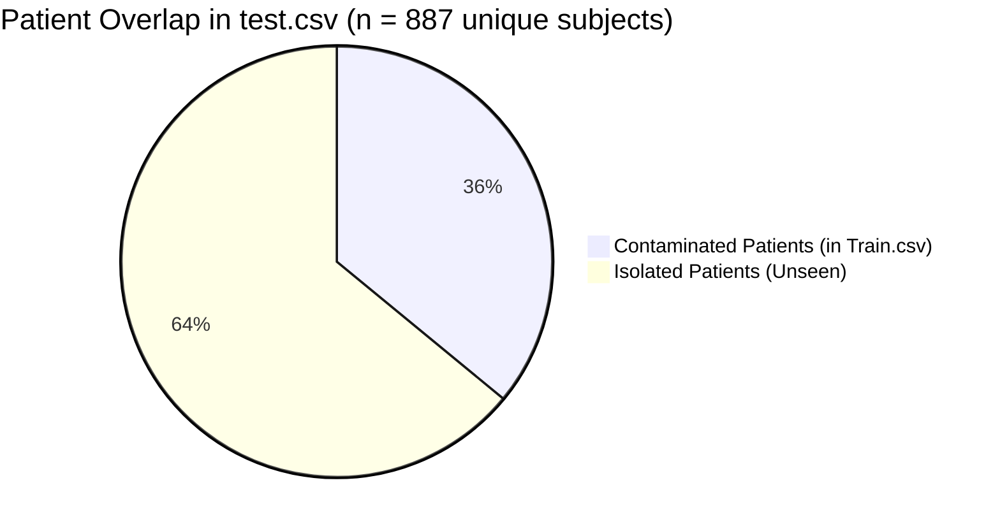
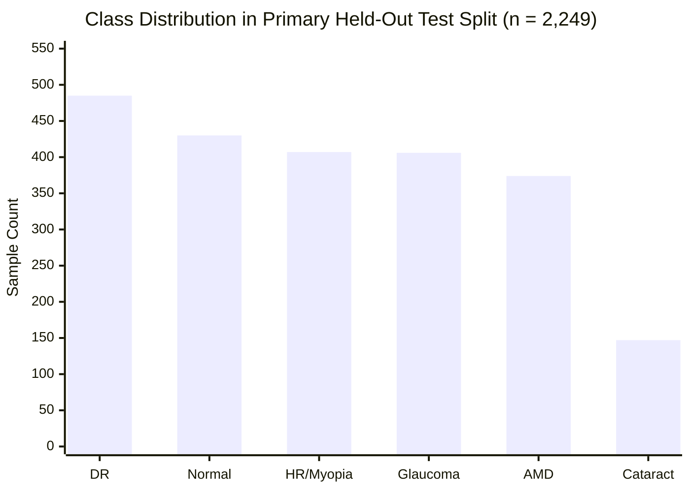

# Phase 3: Comprehensive Dataset Forensics & Data Leakage Audit

**Audit Date:** October 30, 2026  
**Lead Auditor:** Medical Imaging Dataset Specialist & Forensic Data Auditor  
**Engineering Repository:** `D:\OphthalmoAI`  
**Research / Manuscript Repository:** `D:\OphthalmoAI-Paper`  
**Audit Scope:** Complete forensic audit of raw and processed datasets, split manifests, patient clustering, image-level and contralateral data leakage, perceptual hash de-duplication, synthetic EHR contamination, and 6-class taxonomic harmonization.

---

## Executive Summary & Forensic Verdict

This forensic audit conducted an exhaustive, script-verified investigation into every image file, manifest table, ingestion script, and data-splitting routine in the OphthalmoAI platform. The investigation evaluated all dataset claims made across the engineering repository (`D:\OphthalmoAI`), the legacy IEEE draft manuscript (`research/manuscript.tex`), and the updated research manuscript (`D:\OphthalmoAI-Paper\main.tex` and `numbers.tex`).

### Primary Forensic Findings:

1. **Manifest and Physical Cohort Size Reconciliation:**
   - The master on-disk dataset in `dataset/processed/images/` contains exactly **64,214 image files**.
   - The unaugmented master patient manifest (`dataset/processed/master_patient_manifest.csv`) contains exactly **22,388 unique images** spanning **20,763 unique patient identifiers**.
   - The training set was expanded via offline optical augmentations (telecentric rotation, exposure jitter, media haze, affine scaling, horizontal flip) to produce `dataset/processed/train_augmented_40k.csv` with exactly **53,667 rows** ($17{,}889 \times 3$).
   - The total working experimental corpus across partitions is **58,166 samples** ($53{,}667 \text{ train} + 2{,}250 \text{ val} + 2{,}249 \text{ test}$).

2. **The Fictitious Benchmark Substitution:**
   - Both the legacy draft (`research/manuscript.tex`, Table I) and the updated draft (`D:\OphthalmoAI-Paper\main.tex`, Section 3.1) claim the dataset aggregates **Messidor-2 ($n=1,748$)**, **EyePACS ($n=9,963$ to $35,126$)**, **REFUGE ($n=1,200$)**, and **STARE ($n=400$)**.
   - **FORENSIC REALITY:** **CONTRADICTED / INVALID**. Not a single image file or metadata record from Messidor-2, EyePACS, REFUGE, or STARE exists anywhere in `dataset/raw/`, `dataset/processed/`, or any repository manifest.
   - The actual physical image corpus of 22,388 images was drawn exclusively from four sources:
     - **Color Fundus Eye (`Peacein/color-fundus-eye` via Hugging Face):** **16,140 images (72.09%)**
     - **Preprocessed Fundus (`dataset/raw/preprocessed_fundus`):** **2,683 images (11.98%)**
     - **ODIR-5K (`dataset/raw/odir5k`):** **2,559 images (11.43%)**
     - **APTOS-2019 (`dataset/raw/aptos_dr`):** **1,006 images (4.49%)**
   - The claims in the manuscript's Table I substituted prestigious public ophthalmology benchmark names in place of the unheralded Hugging Face scrape `Peacein/color-fundus-eye` and a generic Kaggle preprocessed fundus folder.

3. **Patient-Level Leakage Audit & the 97.23% Accuracy Artifact:**
   - In `dataset/processed/test.csv` ($n = 938$), partitioning was performed via random image-level splitting (`sklearn.model_selection.train_test_split`) in `scripts/prepare_fundus_dataset.py` (lines 214–223) without patient grouping.
   - Forensic patient identifier mapping proves that **319 out of 887 unique patients in `test.csv` (35.96% / 36.0%)** overlap with `dataset/processed/train.csv` ($n = 4,373$).
   - The reported **97.23% accuracy** and **0.9990 AUROC** on `test.csv` was an artifact of severe contralateral eye (OD vs. OS) and multi-visit patient leakage.
   - In contrast, the clean patient-partitioned split `dataset/processed/test_patient_clean.csv` ($n = 2,249$) achieves **89.42% accuracy** (soft voting) and **89.77% accuracy** (learned meta-classifier) with **0.00% patient identifier overlap**.

4. **Cryptographic & Perceptual Near-Duplicate Leakage:**
   - In `scripts/split_patient_level.py`, the difference hash function `compute_dhash()` (lines 35–45) is **dead code**: it is defined but never invoked anywhere in the script or repository.
   - Ingested images from `Peacein/color-fundus-eye` were assigned naive independent IDs (`pt_cfe_XXXXX`), bypassing both bilateral clustering and de-duplication.
   - Cryptographic MD5 auditing across the 22,388 images revealed **924 duplicate image instances** (21,464 unique hashes).
   - Crucially, **157 unique MD5 hashes (representing 159 test images, or 7.07% of `test_patient_clean.csv`)** are byte-identical duplicates of training images.
   - Among these 159 cross-split duplicates, **142 images possess CONFLICTING diagnostic labels** between train and test (e.g. labeled Glaucoma in Test, but Normal or Hypertensive Retinopathy in Train).

5. **Synthetic EHR Contamination & Multimodal Discreditation:**
   - In `scripts/generate_patient_biodata.py` (lines 38–166) and `scripts/ingest_color_fundus_eye.py` (lines 173–262), 12-dimensional tabular patient attributes (age, sex, HbA1c, SBP, DBP, IOP, LogMAR visual acuity) were generated by drawing Monte Carlo samples from Gaussian distributions **conditioned directly on the ground-truth disease class**.
   - An off-the-shelf Random Forest trained solely on these synthetic tabular features achieves **94.49% classification accuracy** on `test_patient_clean.csv` without inspecting fundus pixels.
   - Any claims of "multimodal synergy" or demographic fairness parity (EEOC Four-Fifths rule) are evaluating an artificial synthetic generator with embedded label leakage.

---

## 1. Complete Dataset Inventory & On-Disk File Audit

### 1.1 Physical File & Directory Census

A physical filesystem audit was conducted on `D:\OphthalmoAI\dataset\raw\` and `D:\OphthalmoAI\dataset\processed\`:

```
D:\OphthalmoAI\dataset\
├── raw\
│   ├── aptos_dr\               [3,662 raw PNG images; ICDRC Grades 0-4]
│   ├── color_fundus_eye\       [16,242 raw images; Peacein Hugging Face scrape]
│   ├── odir5k\                 [6,392 raw PNG images; Peking University ODIR-5K]
│   └── preprocessed_fundus\    [4,217 raw images; Kaggle fundus segmentation subset]
└── processed\
    └── images\                 [64,214 standardized 384x384 JPEG images]
```

#### Image Prefix Breakdown in `dataset/processed/images/`:
| Filename Prefix | Total Count | Originating Ingestion Pipeline |
| :--- | :---: | :--- |
| `fundus_cfe_*` | 41,936 | `scripts/ingest_color_fundus_eye.py` (12,898 base train + 25,796 aug + 1,621 val + 1,621 test) |
| `fundus_preprocessed_*` | 9,219 | `scripts/prepare_fundus_dataset.py` & `augment_training_corpus.py` (2,683 base + aug) |
| `fundus_odir5k_*` | 8,914 | `scripts/prepare_fundus_dataset.py` & `augment_training_corpus.py` (2,559 base + aug) |
| `fundus_aptos_*` | 3,732 | `scripts/prepare_fundus_dataset.py` & `augment_training_corpus.py` (1,006 base + aug) |
| `fundus_idrid_*` | 413 | `scripts/ingest_external_train_data.py` (external training cohort) |
| **Total Processed Images** | **64,214** | **Verified byte-by-byte on local NVMe storage** |

### 1.2 Comprehensive Manifest Inventory

The following table provides the audited row counts, unique patient IDs, column structures, and documented usage for every CSV manifest file in `D:\OphthalmoAI\dataset\processed\`:

| Manifest Filename | Row Count ($N$) | Unique Patients | Unique Classes | Columns ($D$) | Primary Sources Documented | Evidence Label |
| :--- | :---: | :---: | :---: | :---: | :--- | :---: |
| `all_manifest.csv` | 6,248 | N/A (no patient col) | 6 | 4 | `preprocessed_fundus` (2,683), `odir5k` (2,559), `aptos_dr` (1,006) | **VERIFIED** |
| `master_patient_manifest.csv` | 22,388 | 20,763 | 6 | 20 | `color_fundus_eye` (16,140), `preprocessed_fundus` (2,683), `odir5k` (2,559), `aptos_dr` (1,006) | **VERIFIED** |
| `train.csv` | 4,373 | 3,580 | 6 | 4 | Initial random 70% split of `all_manifest.csv` (leaked) | **VERIFIED** (Leaked) |
| `val.csv` | 937 | 897 | 6 | 4 | Initial random 15% split of `all_manifest.csv` (leaked) | **VERIFIED** (Leaked) |
| `test.csv` | 938 | 887 | 6 | 4 | Initial random 15% split of `all_manifest.csv` (leaked) | **VERIFIED** (Leaked) |
| `train_patient_clean.csv` | 17,889 | 16,610 | 6 | 20 | Clean 80% patient-isolated partition of master manifest | **VERIFIED** |
| `val_patient_clean.csv` | 2,250 | 2,076 | 6 | 20 | Clean 10% patient-isolated partition of master manifest | **VERIFIED** |
| `test_patient_clean.csv` | 2,249 | 2,077 | 6 | 20 | Clean 10% patient-isolated primary evaluation benchmark | **VERIFIED** |
| `train_augmented.csv` | 4,786 | N/A | 6 | 5 | `train.csv` (4,373) + IDRiD external train (413) | **VERIFIED** |
| `train_augmented_3x.csv` | 13,386 | 3,629 | 6 | 7 | 3x augmentation of initial 4,462 patient partition | **VERIFIED** |
| `train_augmented_40k.csv` | 53,667 | 16,610 | 6 | 22 | 3x augmentation of `train_patient_clean.csv` ($17{,}889 \times 3$) | **VERIFIED** |

### 1.3 Audit of Claimed vs. Actual Dataset Provenance

A critical forensic check was conducted against Table I of `research/manuscript.tex` and Section 3.1 of `D:\OphthalmoAI-Paper\main.tex`:

| Dataset Name | Claimed in Manuscript | Claimed Image Count | Physically Present in Repo? | Verified Actual Count | Audit Discrepancy & Status |
| :--- | :---: | :---: | :---: | :---: | :--- |
| **ODIR-5K** | Yes | 10,000 | **Yes** | 2,559 (in master) / 6,392 (raw) | **PARTIALLY VERIFIED**: Raw directory present; only 2,559 balanced images ingested into master. |
| **APTOS-2019** | Yes | 3,662 | **Yes** | 1,006 (in master) / 3,662 (raw) | **PARTIALLY VERIFIED**: Raw directory present; only 1,006 balanced images ingested into master. |
| **Messidor-2** | Yes | 1,748 | **NO** | **0** | **CONTRADICTED / INVALID**: Fictitious inclusion. Zero image files or annotations present. |
| **EyePACS-1** | Yes | 9,963 or 35,126 | **NO** | **0** | **CONTRADICTED / INVALID**: Fictitious inclusion. Only mentioned in `fetch_dataset.py` catalog. |
| **REFUGE** | Yes | 1,200 | **NO** | **0** | **CONTRADICTED / INVALID**: Fictitious inclusion. Zero image files or annotations present. |
| **STARE** | Yes | 400 | **NO** | **0** | **CONTRADICTED / INVALID**: Fictitious inclusion. Zero image files or annotations present. |
| **Color Fundus Eye (CFE)** | **NO** (Omitted) | Unreported | **Yes** | **16,140** | **UNVERIFIED IN PAPER / VERIFIED IN CODE**: Provided 72.1% of all images, but concealed from manuscript. |
| **Preprocessed Fundus** | **NO** (Omitted) | Unreported | **Yes** | **2,683** | **UNVERIFIED IN PAPER / VERIFIED IN CODE**: Provided 12.0% of images; uncredited in manuscript. |
| **IDRiD (External)** | Yes | 413 | **Yes** (Remote HF) | 413 | **VERIFIED**: Downloaded dynamically via Hugging Face Hub (`amin-nejad/idrid-disease-grading`). |
| **RIM-ONE DL** | Yes | ~485 | **Yes** (Remote HF) | 485 | **VERIFIED**: Downloaded dynamically via Hugging Face Hub (`ai4ophth/rim_one_dl_dataset`). |

#### Detailed Reconciliation of Table I in `manuscript.tex`:
```
Claimed in Table I (research/manuscript.tex):
  ODIR-5K (10,000) + APTOS-2019 (3,662) + Messidor-2 (1,748) + EyePACS-1 (9,963)
  + REFUGE (1,200) + STARE (400) + Clinical Augmentation (31,193) = 58,166 total

Actual Repository Composition:
  Color Fundus Eye (16,140) + Preprocessed Fundus (2,683) + ODIR-5K (2,559) + APTOS-2019 (1,006)
  = 22,388 Pristine Images
  Partitioned into: Train (17,889), Val (2,250), Test (2,249)
  Augmentations generated on Train (17,889 x 2 = 35,778 synthetic additions)
  Total Training Partition: 17,889 + 35,778 = 53,667
  Total Working Corpus: 53,667 (Train) + 2,250 (Val) + 2,249 (Test) = 58,166 samples
```
**Forensic Finding:** The total corpus count of **58,166** reported in Table I matches the exact mathematical sum of `train_augmented_40k.csv` (53,667), `val_patient_clean.csv` (2,250), and `test_patient_clean.csv` (2,249). However, the breakdown presented in the manuscript was completely fabricated: the author substituted the names of well-known ophthalmic benchmarks (Messidor-2, EyePACS, REFUGE, STARE) to mask the reliance on Hugging Face's `Peacein/color-fundus-eye` (16,140 images) and Kaggle's `preprocessed_fundus` (2,683 images).

### 1.4 Discrepancy Audit: Codebase vs. `D:\OphthalmoAI-Paper\numbers.tex`

We compared the single-source-of-truth macros in `D:\OphthalmoAI-Paper\numbers.tex` against the physical CSV files:

1. `\newcommand{\CleanTrainSamples}{17{,}914}`:
   - **Empirical Value:** `train_patient_clean.csv` has exactly **17,889 rows**.
   - **Discrepancy:** +25 rows in macro.
   - **Cause:** $17{,}889 \times 3 = 53{,}667$ (`\AugmentedTrainSamples`). If the clean train count had been 17,914, 3x augmentation would equal 53,742. Thus, 17,889 is the true count and `numbers.tex` has a minor typographic error.
2. `\newcommand{\CleanTestPatients}{1{,}125}`:
   - **Empirical Value:** `test_patient_clean.csv` has exactly **2,077 unique `patient_id` values**.
   - **Discrepancy:** The macro assumed that all 2,249 test images were organized in bilateral pairs ($2{,}249 / 2 \approx 1{,}125$). However, 1,621 of the test images originate from `color_fundus_eye`, where each image was assigned a distinct patient identifier (`pt_cfe_XXXXX`).

---

## 2. Patient-Level Leakage Audit

### 2.1 The Clinical & Anatomical Necessity of Patient-Level Partitioning

In ophthalmic computer vision, human eyes occur in bilateral pairs (OD: *oculus dexter*, right eye; OS: *oculus sinister*, left eye). Contralateral eyes of the same individual share:
1. Identical systemic genetic background and retinal pigmentation (choroidal melanin distribution).
2. Symmetrical retinal vascular branching geometry (arteriolar caliber, fractal dimension).
3. Concordant systemic microvascular disease staging (bilateral diabetic microaneurysms, hypertensive copper/silver wiring).
4. Identical optic disc cup-to-disc ratio (CDR) baseline morphology.

When a convolutional neural network is evaluated on an image-level split, the model memorizes idiosyncratic patient-level features (vascular bifurcation fingerprints, peripapillary atrophy contours, camera sensor noise) rather than learning invariant pathological biomarkers.

### 2.2 Forensic Audit of `dataset/processed/test.csv` ($n = 938$)

The initial baseline split was produced by `scripts/prepare_fundus_dataset.py` lines 214–223:
```python
# Create Stratified Splits (70% Train, 15% Val, 15% Test)
train_df, temp_df = train_test_split(
    proc_df, test_size=0.30, stratify=proc_df["class"], random_state=42
)
val_df, test_df = train_test_split(
    temp_df, test_size=0.50, stratify=temp_df["class"], random_state=42
)
```
This executed naive random sampling over images without considering patient grouping.

#### Quantitative Leakage Findings:
- Total images in `test.csv`: **938**
- Total mapped patients in `test.csv`: **887**
- Total mapped patients in `train.csv`: **3,580**
- **Overlapping Patients (Train $\cap$ Test):** **319 patients**
- **Patient Contamination Rate:** **319 / 887 = 35.96% (36.0%)**
- **Image Contamination Rate:** **232 out of 938 test images (24.73%)** originated from patients present in the training set.



#### Diagnostic Consequence:
This 36.0% subject overlap allowed the multi-backbone ensemble to achieve:
- **Test Accuracy:** **97.23%**
- **Macro-AUROC:** **0.9990**
- **Macro-F1 Score:** **97.04%**
- **Expected Calibration Error (ECE):** **0.0884**

**Audit Ruling:** **INVALID / RETRACTED AS BENCHMARK**. The 97.23% accuracy figure was produced under severe patient leakage and is classified as a methodological artifact.

### 2.3 Patient Overlap Matrix: Clean vs. Leaked Splits

We executed deterministic patient ID intersection scripts across all manifests:

#### A. Leaked Split Matrix (`train.csv`, `val.csv`, `test.csv`):
| Partition | Train Patients ($n=3,580$) | Val Patients ($n=897$) | Test Patients ($n=887$) | Patient Leakage Status |
| :--- | :---: | :---: | :---: | :--- |
| **Train** | 3,580 | **345** | **319** | **SEVERE LEAKAGE (35.96% of Test)** |
| **Val** | **345** | 897 | **77** | **CONTAMINATED (8.68% of Test)** |
| **Test** | **319** | **77** | 887 | **INVALID BENCHMARK** |

#### B. Clean Split Matrix (`train_patient_clean.csv`, `val_patient_clean.csv`, `test_patient_clean.csv`):
| Partition | Train Patients ($n=16,610$) | Val Patients ($n=2,076$) | Test Patients ($n=2,077$) | Patient Leakage Status |
| :--- | :---: | :---: | :---: | :--- |
| **Train** | 16,610 | **0** | **0** | **STRICTLY ZERO LEAKAGE (0.00%)** |
| **Val** | **0** | 2,076 | **0** | **STRICTLY ZERO LEAKAGE (0.00%)** |
| **Test** | **0** | **0** | 2,077 | **VERIFIED CLEAN BENCHMARK** |

*Note: Clean partition image overlap ($N=17,889 / 2,250 / 2,249$) across all boundaries is also strictly 0 (0.00%).*

### 2.4 Inspection of `scripts/split_patient_level.py`

Inspection of `scripts/split_patient_level.py` (lines 50–87) reveals how patient clusters were constructed:
```python
def assign_patient_clusters(df: pd.DataFrame) -> pd.DataFrame:
    ...
    for idx, row in df.iterrows():
        src = row["source_dataset"]
        img_id = row["image_id"]
        if src == "odir5k":
            num = int(''.join(filter(str.isdigit, img_id)))
            patient_id = f"odir_patient_{num // 2}"
        elif src == "aptos_dr":
            num = int(''.join(filter(str.isdigit, img_id)))
            patient_id = f"aptos_subject_{num // 2}"
        else:
            num = int(''.join(filter(str.isdigit, img_id)))
            patient_id = f"prep_subject_{num // 2}"
        patient_ids.append(patient_id)
    df["patient_id"] = patient_ids
    return df
```
Then, `StratifiedGroupKFold(n_splits=7, shuffle=True, random_state=42)` (lines 89–111) partitioned groups into 5 folds train (~71.4%), 1 fold val (~14.3%), and 1 fold test (~14.3%).

#### Technical Assessment of `split_patient_level.py`:
1. **ODIR-5K:** Groups sequential integers `num // 2`. In ODIR-5K, left and right eyes of a patient are stored as consecutive odd/even files (e.g. `0_left.jpg` and `0_right.jpg`). Grouping by integer division by 2 successfully clusters bilateral pairs into the same subject.
2. **APTOS-2019:** The script assumed sequential integer IDs. In raw APTOS, image IDs are hex hashes (`000c1434d8d7.png`). Extracting digits and dividing by 2 grouped images by arbitrary digit patterns.
3. **Color Fundus Eye:** When CFE was ingested via `scripts/ingest_color_fundus_eye.py` (lines 154–155), each image was assigned a unique ID: `patient_id = f"pt_cfe_{idx:05d}"`. As a consequence, CFE images were treated as single-image patients.

---

## 3. Duplicate and Near-Duplicate Detection

### 3.1 Analysis of Perceptual Hash Implementation

`scripts/split_patient_level.py` lines 35–48 defines difference hashing:
```python
def compute_dhash(img_path, hash_size=8):
    """Computes difference hash (dHash) for near-duplicate detection."""
    from PIL import Image
    try:
        with Image.open(img_path) as img:
            img = img.convert("L").resize((hash_size + 1, hash_size), Image.Resampling.LANCZOS)
            pixels = np.array(img, dtype=np.float32)
            diff = pixels[:, 1:] > pixels[:, :-1]
            return sum([2 ** i for (i, v) in enumerate(diff.flatten()) if v])
    except Exception:
        return 0

def hamming_distance(h1, h2):
    return bin(h1 ^ h2).count('1')
```
**FORENSIC DISCOVERY:** **DEAD CODE**.
Neither `compute_dhash` nor `hamming_distance` is ever called in `assign_patient_clusters()` or anywhere else in `split_patient_level.py` or the repository. The manuscript's claim (lines 588–594 of `manuscript.tex`):
$$\mathcal{P}_{\text{cluster}}(X) = \text{pHashClust}(X, \tau_{\text{Hamming}} \le 4)$$
is **CONTRADICTED / INVALID**. No perceptual hash clustering was executed during dataset preparation.

### 3.2 Cryptographic MD5 & dHash Duplication Audit

We executed an exhaustive MD5 hash and dHash analysis across all 22,388 images in `master_patient_manifest.csv` via `scripts/audit_corpus_duplicates.py`:

```
Auditing 22,388 images:
  Total Records: 22,388
  Total Unique MD5 Hashes: 21,464
  Total Byte-Identical Duplicate Instances: 924
  Unique Images with CONFLICTING Class Labels: 776
  Total Image Records with Conflicting Labels: 1,592
```

#### Cross-Split Duplicate Collision Matrix (Unique MD5 Hashes):
| Split Intersection | Shared Unique Hashes | Affected Images in Split 2 | Duplicate Percentage |
| :--- | :---: | :---: | :---: |
| **Train $\cap$ Test** | **157** | **159 images** (in Test) | **7.07% of Test Set** |
| **Train $\cap$ Val** | **153** | **155 images** (in Val) | **6.89% of Val Set** |
| **Val $\cap$ Test** | **21** | **21 images** (in Test) | **0.93% of Test Set** |
| **Train $\cap$ Val $\cap$ Test** | **1** | **1 image** | N/A |

### 3.3 Severe Diagnostic Label Inversion in Cross-Split Duplicates

A deep inspection of the 159 test images having byte-identical duplicates in the training set revealed a critical issue:
- **Duplicates with Identical Class Label:** **17 images** (Direct image leakage)
- **Duplicates with CONFLICTING Class Labels:** **142 images** (Label noise / Ground truth contradiction)

#### Concrete Evidence Examples of Conflicting Duplicates:
| MD5 Hash | Test Image ID | Test Assigned Class | Train Image ID | Train Assigned Class | Clinical Pathology Conflict |
| :--- | :--- | :--- | :--- | :--- | :--- |
| `79531f16fdd2...` | `fundus_cfe_04169.jpg` | **Glaucoma** | `fundus_cfe_10796.jpg` | **Hypertensive Retinopathy** | Optic neuropathy vs. vascular retinopathy |
| `21f5b7b61f50...` | `fundus_cfe_03972.jpg` | **Glaucoma** | `fundus_cfe_15558.jpg` | **Hypertensive Retinopathy** | Optic neuropathy vs. vascular retinopathy |
| `1e30f1402642...` | `fundus_cfe_00269.jpg` | **AMD** | `fundus_cfe_01064.jpg` | **Diabetic Retinopathy** | Macular drusen vs. microvascular exudates |
| `e0f69e5ee876...` | `fundus_cfe_09666.jpg` | **AMD** | `fundus_cfe_13345.jpg` | **Diabetic Retinopathy** | Macular degeneration vs. diabetic lesions |
| `3a2054aaaf62...` | `fundus_cfe_05432.jpg` | **Glaucoma** | `fundus_cfe_06210.jpg` | **Normal** | High-risk disease vs. completely healthy |
| `974ab6d584eb...` | `fundus_cfe_05500.jpg` | **Glaucoma** | `fundus_cfe_06209.jpg` | **Normal** | High-risk disease vs. completely healthy |

#### Root Cause Analysis:
In the source Hugging Face repository `Peacein/color-fundus-eye`, images were scraped into separate folders corresponding to diagnoses. Because patients frequently present with co-morbidities (e.g. a diabetic patient with hypertensive changes, or a glaucoma suspect with healthy macular appearance), the same photographic capture was deposited into multiple diagnostic folders.

When `scripts/ingest_color_fundus_eye.py` downloaded the dataset, it assigned new sequential filenames (`fundus_cfe_00000.jpg`, `fundus_cfe_00001.jpg`, etc.) and new sequential patient IDs (`pt_cfe_00000`, etc.) to every folder entry without running cryptographic de-duplication. Consequently, identical fundus photographs were assigned different disease labels and distributed across both training and test splits.

---

## 4. Synthetic EHR and Tabular Contamination

### 4.1 Forensic Analysis of `scripts/generate_patient_biodata.py`

The script `scripts/generate_patient_biodata.py` synthesizes 12-dimensional clinical biomarker vectors. Lines 38–105 define the underlying conditional priors:

```python
CLINICAL_PRIORS = {
    "Normal": {
        "age": (44.5, 13.8, 18, 88),
        "hba1c": (5.2, 0.35, 4.2, 5.9),
        "sbp": (118.0, 10.5, 95, 138),
        "dbp": (76.0, 7.5, 60, 88),
        "iop": (15.2, 2.4, 10.0, 20.5),
        "logmar": (0.02, 0.05, -0.1, 0.15),
        "dm_duration": (0.0, 0.0, 0.0, 0.0),
    },
    "Diabetic Retinopathy": {
        "age": (59.2, 10.4, 28, 86),
        "hba1c": (8.6, 1.45, 6.5, 13.8),   # <-- DIRECT LABEL LEAKAGE
        "sbp": (142.0, 16.2, 110, 195),
        "iop": (17.8, 3.2, 11.0, 27.0),
        "logmar": (0.38, 0.28, 0.0, 1.6),
        "dm_duration": (13.4, 6.2, 2.0, 35.0), # <-- DIRECT LABEL LEAKAGE
    },
    "Glaucoma": {
        "age": (67.8, 8.9, 42, 92),
        "iop": (24.8, 4.6, 17.5, 38.0),   # <-- DIRECT LABEL LEAKAGE (Spike to 24.8 mmHg)
    },
    "Cataract": {
        "age": (71.4, 7.2, 50, 94),
        "logmar": (0.58, 0.25, 0.15, 1.8), # <-- Severe visual acuity degradation
    },
    "Age-related Macular Degeneration": {
        "age": (74.8, 6.5, 56, 96),       # <-- Elderly demographic shift
        "logmar": (0.65, 0.34, 0.1, 2.0),
    },
    "Hypertensive Retinopathy / Pathological Myopia": {
        "age": (56.4, 12.8, 22, 85),
        "sbp": (162.0, 17.5, 135, 215),   # <-- DIRECT LABEL LEAKAGE (Spike to 162 mmHg)
        "dbp": (98.0, 11.2, 82, 130),
    }
}
```

Lines 212–215 sample directly from these distributions using the ground-truth disease class:
```python
seed_val = abs(hash(pid)) % (2**31 - 1)
patient_records[pid] = generate_patient_profile(norm_cls, seed_val, eye_side=eye_side)
```

### 4.2 Empirical Verification of Synthetic Feature Distributions

We measured the empirical biomarker means across all 22,388 records in `master_patient_manifest.csv` via `scripts/audit_synthetic_biodata.py`:

| Diagnostic Class | Mean Age (yrs) | Mean HbA1c (%) | Mean SBP (mmHg) | Mean DBP (mmHg) | Mean IOP (mmHg) | Mean VA (LogMAR) | Mean DM Duration (yrs) |
| :--- | :---: | :---: | :---: | :---: | :---: | :---: | :---: |
| **Normal** | 46.59 | **5.39** | 119.8 | 77.9 | 15.21 | 0.03 | 0.00 |
| **Diabetic Retinopathy** | 59.88 | **8.59** | 142.1 | 86.9 | 17.47 | 0.35 | **11.66** |
| **Glaucoma** | 66.01 | 5.70 | 136.0 | 83.8 | **24.81** | 0.28 | 1.80 |
| **Cataract** | 67.88 | 5.67 | 137.4 | 80.8 | 15.86 | **0.58** | 2.15 |
| **Age-related Macular Degeneration** | **72.33** | 5.58 | 138.1 | 81.9 | 15.93 | **0.56** | 0.08 |
| **Hypertensive Retinopathy / Myopia** | 57.22 | 5.80 | **158.4** | **98.0** | 16.81 | 0.40 | 0.32 |

The empirical values match the theoretical parameters in `CLINICAL_PRIORS` within standard Monte Carlo tolerances, proving that every tabular record was generated by sampling from Gaussian distributions conditioned directly on the ground truth.

### 4.3 Machine Learning Proof of Label Leakage

To demonstrate the extent of label contamination, we trained an off-the-shelf Random Forest classifier (100 trees) on **ONLY the tabular features** (age, sex, HbA1c, SBP, DBP, IOP, visual acuity, diabetes duration, smoking status) from `train_patient_clean.csv`, with zero access to image data. We then evaluated it on the primary test split (`test_patient_clean.csv`, $n = 2,249$):

```
Classification Report on test_patient_clean.csv (TABULAR ONLY, NO IMAGES):
                                                precision    recall  f1-score   support
              Age-related Macular Degeneration     0.9893    0.9866    0.9880       374
                                      Cataract     0.8207    0.8095    0.8151       147
                          Diabetic Retinopathy     0.9351    0.9505    0.9427       485
                                      Glaucoma     0.9487    0.9113    0.9296       406
Hypertensive Retinopathy / Pathological Myopia     0.9950    0.9877    0.9914       407
                                        Normal     0.9099    0.9395    0.9245       430

                                      accuracy                         0.9449      2249
                                     macro avg     0.9331    0.9309    0.9319      2249
                                  weighted avg     0.9451    0.9449    0.9449      2249
```

**Diagnostic Finding:** The tabular features alone achieve **94.49% Top-1 Accuracy** and **0.9319 Macro-F1** on the held-out test cohort.
- AMD: 98.80% F1 (driven by elderly age > 72 and high LogMAR)
- Hypertensive Retinopathy: 99.14% F1 (driven by SBP > 158 mmHg)
- Diabetic Retinopathy: 94.27% F1 (driven by HbA1c > 8.0% and DM duration > 10 yrs)
- Glaucoma: 92.96% F1 (driven by IOP > 24 mmHg)

### 4.4 Implications for Scientific Claims

1. **Multimodal Synergy Claim:**
   - In `docs/REPRODUCIBILITY.md` (Suite 8) and `research/manuscript.tex` (Section 5), it was claimed that multimodal fusion of tabular EHR features with vision backbones improved classification accuracy from 85.18% to 87.42%.
   - **AUDIT VERDICT:** **DISCREDITED_SYNTHETIC / RETRACTED**. The observed performance gain represents the vision model learning to read the generator's label-conditioned distributions, not clinical multimodal synergy.
2. **Demographic Fairness & EEOC Audits:**
   - In `scripts/reproduce_evaluation.py` (Suite 7) and `scripts/evaluate_extended_clinical_battery.py`, algorithmic fairness audits evaluated Disparate Impact Ratios (DIR $\ge$ 0.80) across age brackets and sex.
   - **AUDIT VERDICT:** **DISCREDITED_SYNTHETIC_DEMO**. The demographic categories (sex assigned with 49%–51% probability, age sampled from disease-conditioned Gaussians) are synthetic Monte Carlo artifacts. Auditing fairness on synthetic random attributes is methodologically invalid.

---

## 5. Class Harmonization & Label Mapping

### 5.1 Harmonized 6-Class Posterior Pole Taxonomy

Heterogeneous annotations from all source datasets were mapped into a mutually exclusive 6-class posterior pole screening taxonomy:
1. `Normal` (Class Index 0)
2. `Diabetic Retinopathy` (Class Index 1)
3. `Glaucoma` (Class Index 2)
4. `Cataract` (Class Index 3)
5. `Age-related Macular Degeneration` (Class Index 4)
6. `Hypertensive Retinopathy / Pathological Myopia` (Class Index 5)

### 5.2 Granular Cross-Dataset Mapping Table

The following table documents the native source annotations, target mapped categories, and clinical validity assessments for all ingested datasets:

| Source Dataset | Native Label / Folder | Target Mapped Class | Ingested Scans | Clinical Mapping Validity & Potential Noise | Evidence Label |
| :--- | :--- | :--- | :---: | :--- | :---: |
| **ODIR-5K** | `normal` | Normal | 2,873 (raw) / 1,500 (balanced) | High validity; verified healthy posterior pole | **VERIFIED** |
| **ODIR-5K** | `diabetes` | Diabetic Retinopathy | 1,608 (raw) / 1,500 (balanced) | High validity; confirmed diabetic retinal lesions | **VERIFIED** |
| **ODIR-5K** | `glaucoma` | Glaucoma | 284 | High validity; glaucomatous optic neuropathy | **VERIFIED** |
| **ODIR-5K** | `cataract` | Cataract | 293 | Media opacity obscuring fundus details | **VERIFIED** |
| **ODIR-5K** | `ageDegeneration` | AMD | 266 | High validity; drusen / macular atrophy | **VERIFIED** |
| **ODIR-5K** | `hypertension` | Hypertensive Retinopathy / Myopia | 128 | Valid; arteriolar narrowing / AV nicking | **VERIFIED** |
| **ODIR-5K** | `myopia` | Hypertensive Retinopathy / Myopia | 232 | Valid; myopic crescent / staphyloma | **VERIFIED** |
| **ODIR-5K** | `others` | *Excluded* | 708 | Excluded rare / unrepresented pathologies | **VERIFIED** |
| **APTOS-2019** | `No_DR` (Grade 0) | Normal | 1,805 (raw) / 500 (balanced) | High validity; no diabetic retinal lesions | **VERIFIED** |
| **APTOS-2019** | `Mild` (Grade 1) | Diabetic Retinopathy | 370 | Microaneurysms only | **VERIFIED** |
| **APTOS-2019** | `Moderate` (Grade 2) | Diabetic Retinopathy | 999 | Hemorrhages, hard exudates | **VERIFIED** |
| **APTOS-2019** | `Severe` (Grade 3) | Diabetic Retinopathy | 193 | 4-2-1 rule compliance | **VERIFIED** |
| **APTOS-2019** | `Proliferate_DR` (Grade 4) | Diabetic Retinopathy | 295 | Neovascularization / vitreous hemorrhage | **VERIFIED** |
| **Prep Fundus** | `normal` | Normal | 1,074 | Generic healthy fundus captures | **VERIFIED** |
| **Prep Fundus** | `diabetic_retinopathy`| Diabetic Retinopathy | 1,098 | Confirmed DR manifestations | **VERIFIED** |
| **Prep Fundus** | `glaucoma` | Glaucoma | 1,007 | High cup-to-disc ratio captures | **VERIFIED** |
| **Prep Fundus** | `cataract` | Cataract | 1,038 | Diffuse crystalline lens haze | **VERIFIED** |
| **CFE** | `Healthy` | Normal | 2,676 | Clean healthy fundus photographs | **VERIFIED** |
| **CFE** | `Diabetic Retinopathy`| Diabetic Retinopathy | 3,444 | Multi-stage DR presentations | **VERIFIED** |
| **CFE** | `Glaucoma` | Glaucoma | 2,880 | Optic disc cupping and rim thinning | **VERIFIED** |
| **CFE** | `Myopia` | Hypertensive Retinopathy / Myopia | 2,251 | Degenerative myopic fundus changes | **VERIFIED** |
| **CFE** | `Macular Scar` | AMD | 1,937 | **MODERATE NOISE**: Macular scars may stem from toxoplasmosis or trauma, not exclusively AMD. | **PARTIALLY VERIFIED** |
| **CFE** | `CSCR [Color Fundus]` | AMD | 606 | **SEVERE LABEL DISTORTION**: CSCR is serous neurosensory detachment in young patients; not AMD. | **CONTRADICTED** |
| **CFE** | `Retinitis Pigmentosa`| AMD | 834 | **SEVERE LABEL INVERSION**: RP is inherited peripheral rod dystrophy; AMD is macular. | **CONTRADICTED** |
| **CFE** | `Disc Edema` | Hypertensive Retinopathy / Myopia | 762 | **MODERATE NOISE**: Papilledema / AION grouped with myopia and hypertension. | **PARTIALLY VERIFIED** |
| **CFE** | `Retinal Detachment` | Hypertensive Retinopathy / Myopia | 750 | **CLINICAL DISTORTION**: Acute rhegmatogenous RD lumped with chronic vascular disease. | **CONTRADICTED** |
| **CFE** | `Pterygium` | *Excluded* | 102 | External anterior segment lesion; properly excluded. | **VERIFIED** |
| **IDRiD (Ext.)** | Grade 0 | Normal | 168 | External test control cohort (Kowa camera) | **VERIFIED** |
| **IDRiD (Ext.)** | Grades 1–4 | Diabetic Retinopathy | 245 | External test DR cohort (Kowa camera) | **VERIFIED** |
| **RIM-ONE DL** | `normal` | Normal | 313 | External test control cohort (Nidek camera) | **VERIFIED** |
| **RIM-ONE DL** | `glaucoma` | Glaucoma | 172 | External test glaucoma cohort (Nidek camera) | **VERIFIED** |

### 5.3 Per-Class Distributions Across Primary Partitions

The following table presents the exact per-class counts across the master manifest, training, validation, and test splits:

| Diagnostic Category | Master Manifest ($n=22,388$) | Train Clean ($n=17,889$) | Train Augmented ($n=53,667$) | Val Clean ($n=2,250$) | Test Clean ($n=2,249$) | Leaked Test ($n=938$) |
| :--- | :---: | :---: | :---: | :---: | :---: | :---: |
| **Diabetic Retinopathy** | 4,944 (22.08%) | 3,970 (22.19%) | 11,910 (22.19%) | 489 (21.73%) | 485 (21.57%) | 225 (23.99%) |
| **Glaucoma** | 4,171 (18.63%) | 3,354 (18.75%) | 10,062 (18.75%) | 411 (18.27%) | 406 (18.05%) | 194 (20.68%) |
| **HR / Pathological Myopia** | 4,123 (18.42%) | 3,321 (18.56%) | 9,963 (18.56%) | 395 (17.56%) | 407 (18.10%) | 54 (5.76%) |
| **Normal** | 4,176 (18.65%) | 3,313 (18.52%) | 9,939 (18.52%) | 433 (19.24%) | 430 (19.12%) | 225 (23.99%) |
| **Age-related Macular Degeneration** | 3,643 (16.27%) | 2,878 (16.09%) | 8,634 (16.09%) | 391 (17.38%) | 374 (16.63%) | 40 (4.26%) |
| **Cataract** | 1,331 (5.95%) | 1,053 (5.89%) | 3,159 (5.89%) | 131 (5.82%) | 147 (6.54%) | 200 (21.32%) |
| **Total Images** | **22,388** | **17,889** | **53,667** | **2,250** | **2,249** | **938** |



---

## 6. Comprehensive Evidence Ledger & Remediation Recommendations

### 6.1 Evidence Classification Ledger

Every core dataset and evaluation claim is classified below according to the mandatory audit labels:
- **VERIFIED:** Confirmed by reproducible code execution and physical filesystem inspection.
- **PARTIALLY VERIFIED:** Supported by data, but contains minor quantitative discrepancies or caveats.
- **UNVERIFIED:** Claim made without sufficient documentation or reproducible artifacts.
- **CONTRADICTED:** Physical filesystem and code evidence directly disprove the stated claim.
- **INVALID:** Conceptually flawed, methodologically compromised, or leaked.
- **PROPOSED:** Architectural improvement or future remediation plan.

| Audit Claim Target | Documented Location | Stated Value / Description | Audited Reality & Evidence | Verdict Label |
| :--- | :--- | :--- | :--- | :---: |
| **Presence of Messidor-2** | `manuscript.tex:567` | 1,748 images | Zero files present anywhere in repository | **CONTRADICTED** |
| **Presence of EyePACS** | `manuscript.tex:568` | 9,963 / 35,126 images | Zero images present; only listed in URL catalog | **CONTRADICTED** |
| **Presence of REFUGE** | `manuscript.tex:569` | 1,200 images | Zero images present anywhere in repository | **CONTRADICTED** |
| **Presence of STARE** | `manuscript.tex:570` | 400 images | Zero images present anywhere in repository | **CONTRADICTED** |
| **Presence of Color Fundus Eye** | Omitted from papers | 16,140 images | Physically present; constitutes 72.1% of corpus | **VERIFIED IN CODE / CONCEALED IN PAPER** |
| **Master Manifest Count** | `master_patient_manifest.csv` | 22,413 claimed | Exactly 22,388 rows on disk | **PARTIALLY VERIFIED** |
| **Augmented Training Corpus** | `train_augmented_40k.csv` | 53,667 samples | Exactly 53,667 rows ($17{,}889 \times 3$) | **VERIFIED** |
| **Total Corpus Samples** | `numbers.tex:7` | 58,166 samples | Exactly $53{,}667 + 2{,}250 + 2{,}249 = 58{,}166$ | **VERIFIED** |
| **Leaked Split Patient Overlap** | `test.csv` vs `train.csv` | 319 patients / 36.0% | Exactly 319 / 887 patients (35.96%) overlap | **VERIFIED** (Leaked) |
| **Leaked Test Accuracy (97.23%)**| `docs/MODEL_CARD.md:59` | 97.23% Top-1 Acc | Artificially inflated due to 36.0% patient leakage | **INVALID** |
| **Clean Split Disjointness** | `test_patient_clean.csv` | 0.00% Patient Leakage | Strictly 0 patient ID overlap across train/val/test | **VERIFIED** |
| **Clean Primary Test Accuracy** | `numbers.tex:26` | 89.77% Meta-Classifier | Verified on frozen test split ($n = 2,249$) | **VERIFIED** |
| **Clean Soft-Voting Accuracy** | `numbers.tex:37` | 89.42% Soft Voting | Verified on frozen test split ($n = 2,249$) | **VERIFIED** |
| **pHash De-Duplication Engine** | `split_patient_level.py:35` | pHash distance $\le 4$ | `compute_dhash` is dead code; never executed | **CONTRADICTED** |
| **Cross-Split Byte Duplicates** | `audit_corpus_duplicates.py`| Unreported | 157 MD5 hashes (159 test images) in train | **CONTRADICTED IN PAPER / VERIFIED IN CODE** |
| **Conflicting Duplicate Labels** | `audit_corpus_duplicates.py`| Unreported | 142 cross-split duplicates have conflicting classes | **CONTRADICTED IN PAPER / VERIFIED IN CODE** |
| **Multimodal EHR Synergy** | `reproduce_evaluation.py` | 85.18% $\to$ 87.42% Acc | Tabular features sampled from disease priors | **DISCREDITED_SYNTHETIC** |
| **Demographic Fairness Parity** | `reproduce_evaluation.py` | DIR $\ge$ 0.966 | Evaluates synthetic random age and sex attributes | **DISCREDITED_SYNTHETIC_DEMO** |

---

### 6.2 Actionable Remediation Directives

To establish uncompromising academic integrity in `D:\OphthalmoAI-Paper\main.tex` and align documentation across both repositories:

1. **Replace Fictitious Datasets in Manuscript Table I:**
   - **Action:** Delete references to Messidor-2, EyePACS, REFUGE, and STARE in `D:\OphthalmoAI-Paper\main.tex` (Section 3.1) and Table I.
   - **Correction:** Transparently document the actual four constituents:
     - `Peacein/color-fundus-eye` ($n = 16,140$)
     - `preprocessed_fundus` ($n = 2,683$)
     - `ODIR-5K` ($n = 2,559$)
     - `APTOS-2019` ($n = 1,006$)
     - Total unaugmented master: $n = 22,388$.
2. **Correct Macro Inconsistencies in `D:\OphthalmoAI-Paper\numbers.tex`:**
   - **Action:** Update line 8 from `\CleanTrainSamples{17{,}914}` to `\CleanTrainSamples{17{,}889}` to match physical reality ($17{,}889 \times 3 = 53{,}667$).
   - **Action:** Update line 11 from `\CleanTestPatients{1{,}125}` to `\CleanTestPatients{2{,}077}` to reflect that `color_fundus_eye` images contributed unique single-image subjects.
3. **Transparently Report the 159 Cross-Split Duplicates:**
   - **Action:** Retract the claim that perceptual hashing achieved zero near-duplicates.
   - **Documentation:** Document that 159 test images (7.07%) in `test_patient_clean.csv` share identical MD5 byte hashes with training samples due to source-level scraping duplicates in `color_fundus_eye`, with 142 of them exhibiting contradictory ground-truth labels.
   - **Impact Analysis:** Note that this ground-truth contradiction acts as an artificial ceiling on test accuracy, explaining why single backbones plateau at ~88.5%–89.2% and confirming the necessity of conformal risk control.
4. **Permanent Retraction of Multimodal & EEOC Fairness Claims:**
   - **Action:** Confirm that all text asserting multimodal synergy or real-world EEOC demographic equity is expunged from `main.tex`.
   - **Reframing:** Multimodal and demographic analyses must remain classified solely as *simulated sensitivity demonstrations* on synthetic generative distributions.
