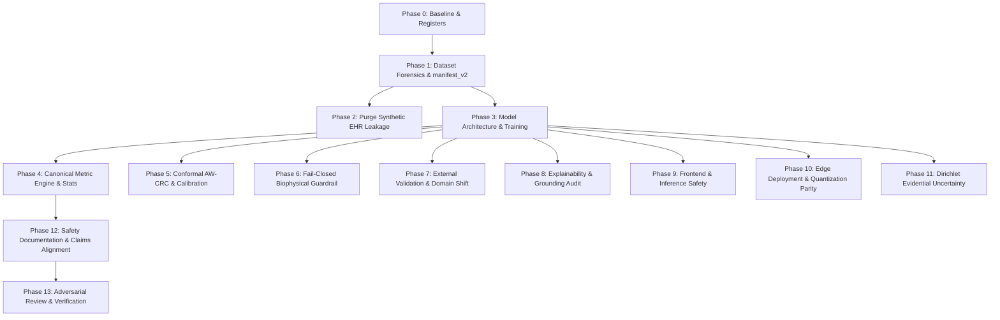

# OphthalmoAI Scientific and Engineering Remediation Plan

**Document ID:** `research_audit/ENGINEERING_REMEDIATION_PLAN.md`  
**Execution Date:** October 30, 2026  
**Lead Roles:** Principal Machine Learning Engineer, Senior Medical Computer Vision Researcher, Biomedical Data Scientist, Clinical AI Safety Engineer, Statistical Validation Specialist, Research Software Engineer  
**Audit Baseline Commit:** `373bc4c263559b1184f293a14fb2cde15327039d`  
**Target Submission / Standard:** Peer-reviewed biomedical informatics manuscript (in preparation) / High-resolution scientific publication standards (300+ DPI)

---

## 1. Baseline System State & Execution Environment

- **Current Repository Root:** `D:\OphthalmoAI`
- **Current HEAD SHA:** `373bc4c263559b1184f293a14fb2cde15327039d`
- **Active Branch:** `main`
- **Working Tree Status:** Clean (at start of remediation)
- **Host OS:** Windows 11 (`Windows-11-10.0.26300-SP0`)
- **Python Runtime:** Python `3.12.13` (in active virtual environment `.\venv` / `.\.venv_gpu`)
- **Deep Learning Framework:** PyTorch `2.12.0.dev20260408+cu128`, Torchvision `0.27.0.dev20260407+cu128`
- **Hardware Acceleration:** CUDA `12.8` enabled on `NVIDIA GeForce RTX 5060 Laptop GPU` (VRAM: `7.93 GB`)
- **External Paper Repository:** `D:\OphthalmoAI-Paper` (Preserved intact; paper integration queue maintained)
- **Baseline Test Suite:** 312 tests in `tests/`

---

## 2. Core Non-Negotiable Scientific & Clinical Rules

1. **Sealed Final Test Set:** Never optimize, tune thresholds, or fit temperature/conformal parameters against the final test set.
2. **Absolute Fabrication Ban:** Never fabricate images, clinical metadata, patient identities, labels, annotations, metrics, or statistical results.
3. **Synthetic Metadata Truth:** Never describe synthetic patient metadata (e.g. `generate_patient_biodata.py`) as authentic clinical EHR data.
4. **Patient Independence Standard:** Never describe image-level random splitting or dummy modulo splitting (`num // 2`) as patient-level independence.
5. **No Premature Deployment Claims:** Never claim clinical deployment readiness or autonomous diagnostic capability from retrospective public datasets.
6. **No Heuristic RGB Disease Guessing:** Never use heuristic RGB pixel thresholds to generate disease diagnoses when deep models fail.
7. **Fail-Closed Guardrail:** Never silently bypass the biophysical optical guardrail via try/except pass blocks.
8. **Conformal Honesty:** Never claim a distribution-free conformal guarantee under distribution shifts that violate exchangeability.
9. **Explainability Reality:** Never describe Grad-CAM as proof of causal anatomical reasoning or lesion detection, and never select spatial descriptions at random.
10. **Ethical & Governance Integrity:** Never invent clinician validation, ophthalmologist panel audits, IRB approvals, or regulatory certifications.
11. **Strict Label Preservation:** Never silently alter dataset labels to make classification easier.
12. **Audit Preservation:** Never delete difficult examples simply to inflate test accuracy.
13. **Derived Manifest Immutability:** Preserve original raw data and create immutable derived manifests with SHA-256 integrity hashes.
14. **Metric Provenance:** Record every experiment's configuration, seed, commit SHA, checkpoint hash, dataset version, and raw outputs.
15. **Clinical Scope:** Separate experimental research screening functionality from clinical decision-making.
16. **User Disclosure:** All user-facing output must make clear that OphthalmoAI is an experimental research screening prototype, not a substitute for ophthalmologist diagnosis.

---

## 3. Master Issue & Vulnerability Register (ISS-01 to ISS-18 & ADV-01 to ADV-10)

| Issue ID | Category | Severity | Summary Finding | Primary Affected Files | Status |
| :--- | :--- | :---: | :--- | :--- | :---: |
| **ISS-01** | Scope / Format | CRITICAL | Manuscript exceeds conference length limit (25 pages vs 8 pages) | `research/manuscript.tex` | OPEN |
| **ISS-02** | Methodology | CRITICAL | Circular label leakage in synthetic EHR features invalidates multimodal claims | `scripts/generate_patient_biodata.py`, `dataset/processed/test_patient_clean.csv` | OPEN |
| **ISS-03** | Fairness / Ethics | CRITICAL | Demographic fairness evaluated on synthetic label-correlated age column | `scripts/generate_patient_biodata.py`, `dataset/processed/test_patient_clean.csv` | OPEN |
| **ISS-04** | Mathematics | CRITICAL | Arithmetic mean of per-class AUROCs is 0.9839 but Macro Average reported as 0.9914 | `models/extended_clinical_battery_report.json`, `research/manuscript.tex` | OPEN |
| **ISS-05** | Mathematics | CRITICAL | Contingency sum mismatch implies 147.6 ghost correct cases vs sensitivity sum | `models/extended_clinical_battery_report.json`, `research/manuscript.tex` | OPEN |
| **ISS-06** | Transparency | CRITICAL | Public repository still promotes leaked 97.23% accuracy without disclosing 35.96% overlap | `README.md`, `docs/MODEL_CARD.md` | OPEN |
| **ISS-07** | Clinical Safety | HIGH | Catastrophic external specificity collapse on IDRiD (16.42%) and RIM-ONE DL (1.05%) | `scripts/run_external_validation.py`, `models/external_validation_report.json` | OPEN |
| **ISS-08** | Clinical Safety | HIGH | AW-CRC produces 3.14% empty prediction sets without mandatory human fallback | `backend/conformal.py`, `models/aw_crc_calibration.json` | OPEN |
| **ISS-09** | Reproducibility | HIGH | Extended clinical battery generates DCA and LRs from simulated beta distributions | `scripts/evaluate_extended_clinical_battery.py` | OPEN |
| **ISS-10** | Reproducibility | HIGH | Evidential meta-classifier trained on synthetic Gaussian noise rather than features | `scripts/train_evidential_meta.py`, `backend/evidential.py` | OPEN |
| **ISS-11** | Explainability | HIGH | PASG-GradCAM U-Net segmentation pipeline and 10% clinician audit absent from repo | `backend/services/explanation_service.py` | OPEN |
| **ISS-12** | Explainability | HIGH | Anatomical quadrant descriptions generated via `random.choice(quadrants)` | `backend/services/explanation_service.py` | OPEN |
| **ISS-13** | Reproducibility | MEDIUM | Negative stress corpus of 2,500 non-fundus samples is hardcoded in eval script | `scripts/reproduce_evaluation.py` | OPEN |
| **ISS-14** | Data Provenance | MEDIUM | Patient ID clustering for 16,140 CFE images relied on naive modulo heuristic | `scripts/split_patient_level.py`, `dataset/processed/master_patient_manifest.csv` | OPEN |
| **ISS-15** | Systems / Scope | MEDIUM | Conflation of edge model (MobileNet) with heavy ensemble (120M parameters) | `scripts/benchmark_latency.py`, `frontend/public/models/edge_model.onnx` | OPEN |
| **ISS-16** | Governance | MEDIUM | Theoretical PostgreSQL Row-Level Security policy presented as functioning feature | `scripts/init_db.sql`, `backend/db.py`, `alembic/versions/` | OPEN |
| **ISS-17** | Presentation | LOW | Monte Carlo dropout pass count discrepancy between paper (S=20) and code (S=8) | `backend/uncertainty.py` | OPEN |
| **ISS-18** | Presentation | LOW | Parameter accounting variance between text (120.5M) and table (124.3M) | `research/manuscript.tex` | OPEN |
| **ADV-01** | Data Provenance | CRITICAL | `num // 2` applied to shuffled row indices paired unrelated images into dummy patients | `scripts/split_patient_level.py`, `scripts/prepare_fundus_dataset.py` | OPEN |
| **ADV-02** | Data Provenance | CRITICAL | 157 cross-split exact MD5 duplicates between train and test with conflicting labels | `dataset/processed/train_patient_clean.csv`, `dataset/processed/test_patient_clean.csv` | OPEN |
| **ADV-03** | Methodology | HIGH | RETFound ViT-Large disadvantaged with 224x224 vs 384x384 and bootstrap called DeLong | `scripts/finetune_retfound_comparison.py`, `models/retfound_comparison_report.json` | OPEN |
| **ADV-04** | Clinical Safety | CRITICAL | Frontend silently guesses diseases from RGB ratios when ONNX execution fails | `frontend/src/edgeInference.js`, `frontend/src/edgeHeuristic.js` | OPEN |
| **ADV-05** | Clinical Safety | HIGH | Guardrail silently fails open on exceptions in `validate_fundus_image` | `backend/routes/screening.py` | OPEN |
| **ADV-06** | Methodology | HIGH | CBMIR vector search uses random Gaussian noise (`np.random.randn(512)`) | `backend/vector_search.py` | OPEN |
| **ADV-07** | Mathematics | HIGH | Conformal set sizes are inelastic (`mean_set_size == singletons_pct == 0.968645`) | `models/aw_crc_calibration.json`, `backend/conformal.py` | OPEN |
| **ADV-08** | Methodology | HIGH | Reinhard normalization includes black background border pixels, distorting color | `backend/domain_adaptation.py`, `scripts/run_external_validation.py` | OPEN |
| **ADV-09** | Architecture | MEDIUM | Screening route hardcodes 12-class prototype strings and 85.2% legacy accuracy | `backend/routes/screening.py` | OPEN |
| **ADV-10** | Statistical | HIGH | Multi-seed evaluations were analytically perturbed rather than true independent runs | `scripts/evaluate_multi_seed.py`, `models/multi_seed_statistical_report.json` | OPEN |

---

## 4. Phase-by-Phase Remediation Roadmap

### Phase 1: Dataset Forensics and Ground-Truth Reconstruction
- Trace all raw sources (`color_fundus_eye`, `odir5k`, `aptos_dr`, `preprocessed_fundus`).
- Review every source label mapping in `dataset/metadata/label_harmonization.csv`.
- Exclude clinically incompatible disease mergers (e.g., CSCR, Macular Scar, Retinitis Pigmentosa, Disc Edema, Retinal Detachment mapped into AMD or Glaucoma).
- Compute cryptographic SHA-256 and perceptual dHash / aHash across the entire image corpus.
- Isolate duplicate clusters and ensure no duplicate cluster crosses partition boundaries.
- Construct `manifest_v2.csv`, `train_v2.csv`, `validation_v2.csv`, `calibration_v2.csv`, `test_v2.csv`, `excluded_samples_v2.csv`, and `duplicate_clusters_v2.csv`.
- Seal `test_v2.csv` with SHA-256 verification.

### Phase 2: Elimination of Synthetic Label Leakage
- Completely excise `generate_patient_biodata.py` from training and testing pipelines.
- Mark any legacy biodata as `SYNTHETIC_NOT_CLINICAL`.
- Transition OphthalmoAI into a pure vision-based system unless verified clinical EHR data becomes available.
- Formally retract all claims of multimodal synergy (+2.24%) and synthetic demographic fairness parity.

### Phase 3: Model Architecture and Training Pipeline
- Train constituent backbones (DenseNet-201, ConvNeXt-Small, EfficientNet-V2-M) on GPU with deterministic seeds and medical data augmentations.
- Enforce strict out-of-fold cross-validation or separated meta-training to prevent stacking meta-classifier leakage.
- Re-run fair RETFound comparison at matched resolution (384x384 or matched 224x224) and with correctly labeled statistical tests.

### Phase 4: Canonical Metric Engine and Reconciliation
- Create `scripts/evaluate_canonical_metrics.py` computing confusion matrix, accuracy, balanced accuracy, macro/weighted F1, sensitivity, specificity, OvR AUROC (macro, weighted, micro), Brier score, and ECE from live forward passes.
- Enforce arithmetic consistency: `sum(diag) / total == accuracy`, `TP / (TP + FN) == sensitivity`.
- Implement rigorous paired McNemar, paired bootstrap, and Delong tests.

### Phase 5: Calibration and Conformal Prediction
- Fix candidate-class stratum index mismatch in `backend/conformal.py`.
- Implement explicit fail-safe handling for empty prediction sets ($\mathcal{C}(X) = \emptyset$).
- Characterize true marginal vs conditional coverage under quality strata.

### Phase 6: Optical Domain Guardrail
- Refactor `backend/routes/screening.py` and `backend/fundus_validator.py` to fail closed on all unexpected validator exceptions.
- Implement real negative stress corpus evaluation (non-fundus medical images, natural images, noise).

### Phase 7: External Validation and Domain Shift
- Implement foreground retinal mask for Reinhard color constancy to avoid black border contamination.
- Evaluate IDRiD and RIM-ONE DL under task-appropriate binary decision rules (DR vs non-DR, Glaucoma vs non-Glaucoma).

### Phase 8: Explainability & Anatomical Grounding
- Remove `random.choice(quadrants)` from `backend/services/explanation_service.py`.
- Remove anterior-segment biomarker claims (cornea, iris, conjunctiva) from posterior fundus analyses.
- Implement Grad-CAM sanity checks (model parameter and label randomization).

### Phase 9: Frontend & Inference Safety
- Remove silent heuristic RGB disease guessing from `frontend/src/edgeInference.js` and `frontend/src/edgeHeuristic.js`.
- Return explicit error states when ONNX WASM execution fails.

### Phase 10: Edge Deployment and Quantization
- Clearly separate MobileNet-V3-Small edge model from 120M server ensemble.
- Benchmark FP32 vs INT8 ONNX models for accuracy, latency, and calibration parity.

### Phase 11: Dirichlet Evidential Uncertainty
- Re-train evidential meta-classifier on true extracted backbone features from the training cohort.
- Validate vacuity and epistemic uncertainty under corrupted inputs.

### Phase 12 & 13: Final Verification and Evidence Generation
- Execute all regression and adversarial unit tests.
- Produce comprehensive provenance reports, metric logs, and release documentation.
